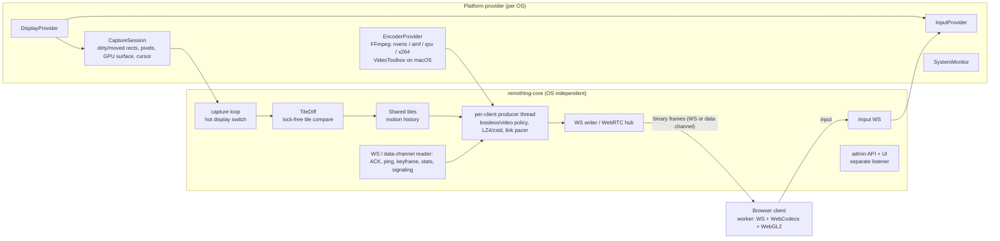
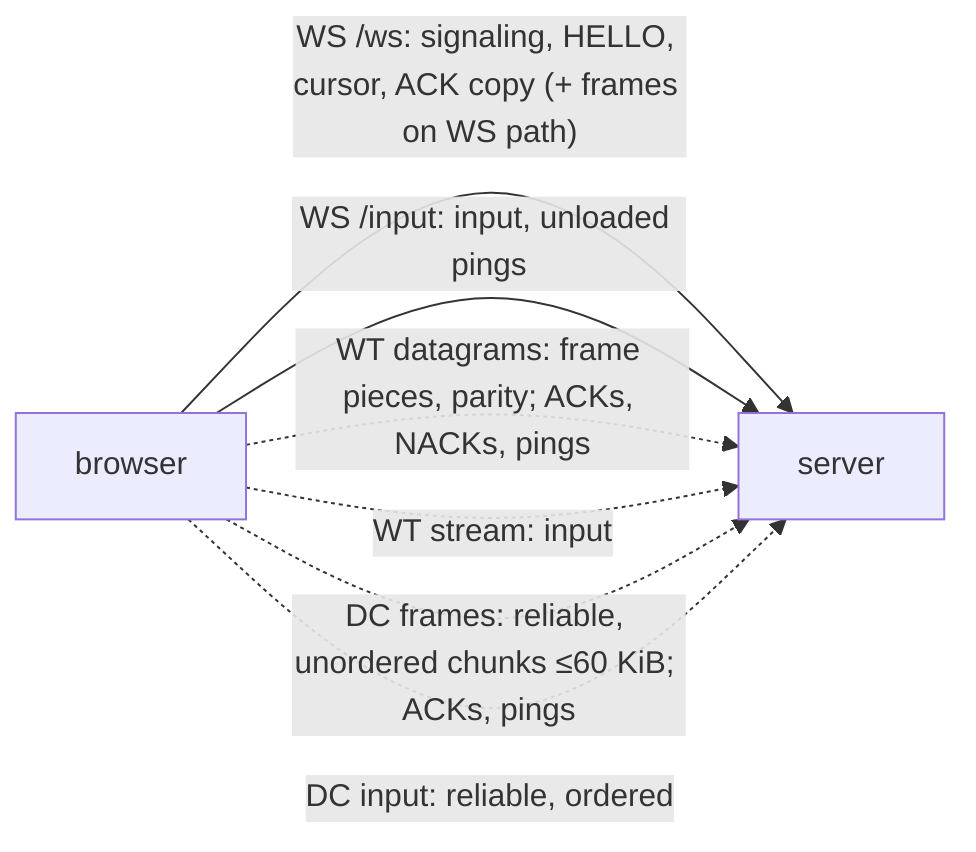

# remothing — architecture

Low-latency streaming of a desktop (or one application) to a browser. One native
binary per platform (Linux, Windows, macOS: `remothing` / `remothing.exe`),
built from one Cargo workspace; OS specifics live in providers selected with
`cfg(target_os)`.

## Crates

| crate | role |
|---|---|
| `crates/core` | traits (`platform.rs`, `encode.rs`), tile diff + motion classification + policy (`shared.rs`), capture loop (`capture.rs`), wire protocol (`proto.rs`), transport (`stream.rs`), sound hub (`audio.rs`), admin API (`admin.rs`), config/auth (`config.rs`), embedded web assets, server wiring (`app.rs`) |
| `crates/encoder` | `EncoderProvider`: through FFmpeg H.264 with NVENC / AMF / QuickSync / x264, HEVC and AV1 with NVENC, low-latency settings, zero-copy CUDA (Linux) and D3D11 (Windows) input, host-memory fallback; on macOS VideoToolbox directly (H.264, HEVC) with IOSurface input; Opus (libopus) or AAC for sound |
| `crates/gpu-interop` | GPU surface types shared by capture and encoder of one platform (`D3D11Frame`, macOS `PixelBufferFrame`) |
| `crates/platform-linux` | Xvfb manager (simulated displays, shared-memory framebuffer + XDamage), real X11 displays (RandR outputs, XShm + XDamage), XTest input, XFixes cursor, X selections (clipboard), sound through PulseAudio / PipeWire / ALSA loopback helpers, NVML/DRM GPU info |
| `crates/platform-windows` | DXGI Desktop Duplication (dirty + move rects, D3D11 texture), SendInput, cursor from duplication, clipboard, WASAPI loopback sound, desktop switching, Windows service supervising the session process |
| `crates/platform-macos` | ScreenCaptureKit capture (changed areas from the frame info, IOSurface frames) and system sound, Quartz event injection, system cursor, general pasteboard, permission checks, launch agent |
| `crates/server` | the `remothing` binary: CLI, config path, picks the platform |
| `testapp` | `rt-testapp`: latency probe app (barcode with timestamp + input marker), X11 and Win32 backends |
| `client` | browser client (`index.html`, `main.ts`, `worker.ts`; input and touch `input.ts`, the controls menu `ui.ts` with its Displays page `displays.ts`, `keyboard.ts`, `textentry.ts`, sound `audio.ts`) and admin UI (`admin.html`, `admin.ts`) |

## Frame path

1. **Capture** (`CaptureSession::next_frame`): the provider reports dirty
   rectangles (XDamage / DXGI dirty+move rects), optional move rects and a
   capture timestamp.
2. **Moves**: provider moves (DXGI) — or, for damage-only providers, a
   vertical scroll detected by row hashing (`Differ::detect_scroll`) — are
   applied to the shared screen copy first, so scrolled content is not seen as
   changed; clients replay them as GPU copies on their lossless layer and only
   the newly exposed strip travels.
3. **Diff** (`pixels::Differ`, capture thread): 64×64 tiles touched by the
   damage are compared with the shared screen copy (`pixels::Pixels`, one lock
   per tile row) and changed tiles are written in place. Pixels come straight
   from mapped memory (Xvfb shm) or via `read()` (XShm, D3D11 staging copy of
   the dirty tiles only). With a GPU capture surface, tiles that every client
   shows from video and whose encoder reads the GPU surface are not read back
   at all; their CPU copy is refreshed once they settle, before the lossless
   refine.
4. **Commit** (`Shared::commit`, short metadata lock): motion history, per
   client dirty/encoder-stale flags and pending moves; client threads woken.
5. **Per-client producer** (`stream.rs::produce`, one OS thread per client):
   when the client's link window allows (see *Link model*), `Shared::pull`
   builds a frame:
   - tiles changing ≥20 Hz whose lossless cost exceeds the per-frame limit or
     half of the link budget switch to the **video layer**; everything else
     is sent **lossless** (rows of tile runs: LZ4, or zstd when the link is
     under 200 Mbit/s — 1.7× smaller on desktop content);
   - a one-off change too big for ~64 ms of link time (window opened, page
     loaded) is shown from video first and refined afterwards;
   - video tiles unchanged for 250 ms (or still moving but affordable
     losslessly) are re-sent losslessly, paced by a token bucket at 80 % of
     the link so fresh changes find no queue → anything that stops moving
     becomes pixel-exact;
   - when a video tile changed, only the changed tiles are uploaded to the
     encoder input (CUDA surface / D3D11 texture copy / host frame) and one
     access unit is encoded (no B-frames, no lookahead, IDR on demand; see
     "Video codecs" for which codec and how each avoids output reordering).
     Video frames are paced to 70 % of the link and the encoder's bitrate
     cap follows the same share (NVENC VBR / x264 CRF with VBV, QP floor 20,
     60 on AV1's scale). The cap is for the frame rate the client shows
     (its refresh rate, at most the display's; 60 until it says): a frame
     may take cap / rate, so that many fit the share. NVENC's rate control
     counts frames, not time, and assumes 60 a second, so the cap it gets
     is scaled by 60 / rate (`rate_control_bitrate`); x264 follows the
     timestamps and takes it as it is. Unscaled, heavy content at a
     120 Hz client came as frames twice the size the share has room for,
     and pacing sent half of them, each one waiting for its turn (a game
     at 4K: 280 KB frames, 60 a second, 7-10 ms of waiting; RESULTS,
     "A game at 4K for a 120 Hz client").
     Cap changes cost an IDR with NVENC, so they need a clear shift and hold
     3 s unless the link collapses; a change of the client's frame rate is
     applied at once.
6. **Client** (`worker.ts`): frames are applied in order and atomically —
   moves, then lossless rects to one texture, decoded VideoFrame to another;
   a per-tile mask picks the layer in the WebGL2 shader. ACK after drawing,
   carrying the time the frame was held (receive → draw). zstd is decoded in
   WASM (`zstddec`, ~1.5 GB/s; pure-JS decoders stall the worker).

## Video codecs

H.264, HEVC or AV1, chosen per client (`stream.rs::pick_codec`):

- **The client's offer.** Before connecting, the worker asks WebCodecs
  (`isConfigSupported`, `prefer-hardware`, 3840x2160, `optimizeForLatency`)
  for HEVC and AV1 and lists those decoded in hardware in the stream
  socket's query (`codecs=hevc,av1`); a software decoder would cost more
  than the bits saved. H.264 is always possible. `?codec=` in the page URL
  limits the offer to one codec (tests).
- **The server's choice.** `encoder.codec = "auto"` takes the first of AV1,
  HEVC, H.264 that the client offers and an encoder here encodes (probed
  at start, per backend and codec); a named codec is used when both sides
  have it, else H.264. A codec that fails to open falls back to H.264 (an
  event in the log). Changing the setting rebuilds every client's encoder.
  HEVC and AV1 come only from NVENC: AMF and QuickSync have them too, but
  their output was never checked here.
- **On the wire** the codec is in bits 3-4 of a FRAME's flags; a change
  comes with a keyframe and the client reconfigures its decoder for it.
  A decoder error on HEVC or AV1 (said to be supported, yet failing) drops
  that codec from the client's offer and reconnects, so the server picks
  again without it.
- **No reordering.** Browsers hold a picture back when the stream allows
  reordering. H.264 says it cannot through constraint_set3 in the SPS
  (`mark_no_reorder`); HEVC's SPS carries the reorder count, zero without
  B-frames; AV1 has no output reordering. Measured: decode p50 0.4 ms
  (H.264, AV1) and 0.6 ms (HEVC) at 165 fps, far below a frame interval.
- **Why AV1 first:** at the same quality (PSNR against a lossless
  recording) it needs 40-60 % of H.264's bytes, which slow links turn into
  frame rate and latency (docs/RESULTS.md, "Video codecs"). HEVC matched
  H.264 on moving pictures and saved 10-15 % on text.
- **Split-frame encoding** (HEVC, AV1; FFmpeg 7.1 or later, so Windows
  here, not the Ubuntu 24.04 container's 6.1): forced on, the GPU's NVENC
  units take a strip each; the driver's own choice splits only at 4K.
- **Two-pass** (H.264 on NVENC only, `multipass=qres`): a quick pass at a
  quarter of the size plans each frame, so sizes come out even. It costs
  0.6 ms of encode at the median (4 ms at p99), which on a fast near link
  is 10-20 % of the frame rate; on slow or distant links the even sizes
  win (docs/RESULTS.md, "Two-pass on slow links"). On while the video cap
  is below 20 Mbit/s or the round trip is 50 ms or more; off once the cap
  is above 30 Mbit/s and the round trip below 35 ms (`wants_two_pass`).
  The cap alone misses slow links that video does not fill (the estimate
  stays above them). Switching needs another encoder, and opening one
  takes NVENC about 250 ms: it opens on its own thread while the current
  one keeps encoding, then takes over with a keyframe. HEVC and AV1 gained
  nothing measurable from it.
- **Colour matrix.** Tiles carry exact RGB; video turns it into YUV and
  the browser turns it back, so both ends must use the same matrix or
  moving areas change colour when they turn into video (up to 39 levels on
  saturated colours, measured). NVENC converts RGB input (D3D11 BGRA, CUDA
  or system-memory BGRZ) itself, always with BT.601; swscale (x264, AMF and
  QuickSync from system memory) and the video processor convert to BT.709;
  VideoToolbox converts with the BT.709 its pixel buffers are tagged with
  (not measured). Each stream signals its own matrix, and each FRAME with
  BT.601 video has `FLAG_BT601`. Chromium ignores what the stream signals
  (it takes BT.709 for every codec), so the client sets the matrix in the
  decoder's configuration (`colorSpace`). Where that does not take, the
  client sees it and asks for BT.709 (`C_BT709`): the decoded frames keep
  another matrix than the one configured (Chromium's HEVC), or a BT.601
  test frame drawn the way video is drawn reads back in the wrong colours
  (`Renderer.showsBt601`, once at start). The server then converts to
  BT.709 itself for that client: on D3D11 the video processor turns the
  BGRA copy into NV12 for NVENC; on Linux NVENC takes swscale's NV12 from
  system memory instead of the CUDA path. That conversion costs NVENC
  +0.05 to +0.1 ms per frame with AV1 and up to +1.1 ms with H.264 at 4K
  (docs/RESULTS.md, "Video colour matrix"), so it is only done where the
  browser needs it; swscale's BT.709 costs nothing over its BT.601.

## HDR

A display in HDR mode (Windows) is streamed either as a correct SDR
picture or, when every connected client can show it, as an HDR picture.

- **Why not Windows' own conversion.** In HDR mode the desktop is
  composed in linear light, 16-bit float, 1.0 = 80 nits (scRGB); ordinary
  programs sit at the "SDR content brightness" level. Asked for 8 bits,
  Desktop Duplication cuts off at 80 nits: at 280 nits the picture came
  out 3.5 times too bright and every light grey white (measured). So the
  session asks for the float image (`DuplicateOutput1` with float first)
  and converts it itself (`platform-windows/src/hdr.rs`), on the GPU,
  relative to the host's SDR white read from Windows
  (`DISPLAYCONFIG_SDR_WHITE_LEVEL`) and the display's peak
  (`IDXGIOutput6::GetDesc1`). Both are read again every second; the
  slider has no event.
- **SDR picture**: up to SDR white exactly the sRGB an SDR program drew
  (all 256 levels round-trip at 80-480 nits, computed with the float16
  composition); brighter, real HDR content is scaled into range and turned
  towards white as it nears the display's peak, per pixel and the same way
  every frame (unchanged areas must stay unchanged). Colours outside sRGB
  move towards the grey of their luminance. Every client gets it; tiles,
  video and client are as for any display. A new slider position converts
  the float copy again; SDR programs' pixels do not change.
- **HDR picture** (`platform::Picture`, `proto::S_HELLO`): each channel's
  linear value relative to SDR white, up to the peak (`hdr_max`, e.g.
  465 / 280 = 1.66), through one curve: sRGB scaled to the first
  `hdr_split(hdr_max)` of the codes, logarithmic above, the two meeting
  with the same slope. Tiles carry it in 10 bits (`R10G10B10A2`, still
  4 bytes per pixel, compared and compressed like BGRX); video in 8 bits,
  signalled as ordinary SDR so the browser passes the samples untouched
  (a stream signalled as HDR is tone-mapped differently by every browser
  path; decoded pictures reach WebGL with 8 bits whatever was sent). Any
  codec carries it. Encoders fed from the CPU get the tiles turned into
  8 bits (`Pixels::with_band_8bit`); the D3D11 input reads the 8-bit
  output of the same pass.
- **One picture for all** (`Shared::hdr_wanted`): HDR only while every
  client says it can show it (`C_VIEW` flag `VIEW_HDR`); otherwise SDR. A
  change of that, of the display's HDR mode or of an HDR picture's levels
  opens the display again (`CaptureSession::picture`), which every client
  sees as a new HELLO. Windows' colour management on an SDR display can
  also deliver float images: they get the SDR conversion.
- **Client** (`renderer.ts`): a page that starts on an HDR screen
  (`dynamic-range: high`) asks WebGL for a non-opaque canvas (an opaque
  one refuses a float drawing buffer) and, with `EXT_color_buffer_float`
  and `drawingBufferStorage`, reports HDR. For an HDR picture the drawing
  buffer becomes `RGBA16F` and the shader decodes the curve to linear and
  writes extended sRGB, above 1 for highlights. A canvas drawn from a
  worker only shows above 1 while the page's own thread shows something
  in HDR (measured in Edge 156): a 1-pixel WebGPU canvas in `extended`
  mode is kept in a corner while the picture is HDR (`main.ts` `pageHdr`).
  A client given an HDR picture it cannot show (the moment between
  connecting and the server reopening in SDR) decodes it clipped at white.
- **Linux**: X11 has no HDR, so every picture is SDR; HDR there exists
  only under Wayland compositors, which are not captured.

## Motion mode

For a screen that moves as a whole: a game, a full-screen video. Weighing
tile by tile what goes to video and refining every tile that rests for a
quarter of a second suits a desktop; here it only costs: parts of the
picture hop between the layers, and every pause sends a burst of exact
pixels that is thrown away a moment later.

- **The switch** is automatic and per display (`MotionDetector` in
  `shared.rs`, sampled by the capture thread on every pass). A second is
  "moving" when at least half of the tiles were changing at 20 Hz or more
  for most of it. Ten moving seconds in a row enter the mode; forty quiet
  ones in a row leave it. Quick in and slow out on purpose: opening a
  short video, going back to folders and opening another must not flip
  the mode each time, and the mode is the safe one to be in by mistake
  (a desktop shown as video is softer, not slower).
- **In the mode** every tile that changes is shown from video at once,
  whatever it would cost losslessly, and no tile goes back to lossless
  while anything on the screen still changes. Video frames, their pacing
  and the bitrate cap are those of the frame path above. With GPU capture
  and GPU encoders no pixel is read back meanwhile.
- **The exact picture** follows once the whole screen has been still for
  5 s: the video tiles are re-sent losslessly, paced by the link as any
  refinement. A change before it is complete stops it (the tiles not yet
  sent stay video); tiles that are exact and do not change stay exact.
- **Size per client**: the client reports how it shows the picture
  (`C_VIEW`: its size in the window in device pixels, 3 s after the window
  last changed, and its refresh rate, from 60 animation frames). In motion
  mode the encoder encodes the largest of that size, the display's, and
  ¾, ⅔ and ½ of the display that fits the video cap at 0.1 bit per pixel
  and refresh (`video_size`, a first guess); never below the client's
  size. Every change is a new encoder and a keyframe, so a larger size
  waits until the link has had room for 10 s (0.5 s while slow start is
  still raising the estimate), a smaller one comes at once, and leaving
  the mode goes straight back to the display's size (tiles need it). The
  client samples the smaller picture to the screen (bilinear). Scaling:
  Windows' D3D11 input keeps a full-size copy of the changed regions that
  the GPU video processor scales into the encoder texture before each
  frame; the system-memory and CUDA inputs scale on the CPU (swscale,
  fast bilinear), the CUDA one then uploads the whole scaled picture.
- **Frame rate per client**: frames go at most once per client refresh,
  lossless ones too and in every mode (more than the screen shows are
  replaced before it shows them, and decoding them costs the client
  refreshes): changes wait and go together in the next frame, on a grid
  of slots that moves one refresh per frame. A capture up to half a
  refresh early for its slot goes at once (a short wait costs a thread
  wake-up that often comes milliseconds late), and after a gap up to two
  frames catch up. `?bench` reports no view: it measures the pipeline at
  the display's size and the capture rate.
- Clients without a video encoder are not affected: lossless is all they
  have. FRAME carries the mode as a flag, for the overlay and the event
  log.

## Link model

`pacer.rs`, per client, from frame ACKs (client hold time subtracted, so
only the network is modelled; a slow client still holds frames back):

- **Bandwidth estimate**: raised by measured delivery rates (BBR-style
  samples, transmission time of large frames); steered by the standing queue
  — the least ACK delay beyond base RTT and the frame's own transmission over
  a window of about one RTT, so single late ACKs (relay jitter) are ignored.
  Proportional control toward 12 ms of queue (±4 %/RTT, accelerating after a
  deep cut); an emergency cut to the measured delivery rate beyond 30 ms.
  Growth needs content that waited for the estimate (byte window full or
  pacing deferred something) and used at least a quarter of it, or content
  that used half of it; frames waiting on a client that has not drawn the
  previous ones do not count (on short paths that made it grow without
  bound), and neither does content held back by the configured bandwidth
  or the client's refresh rate: with light content no queue ever shows,
  so the estimate grew a few percent per window for good (3.2 million
  Mbit/s on a 4 ms Wi-Fi path, sending unpaced). A delivery rate is
  measured over at least a base round trip and 1 ms, so frames handed over
  together (a TCP stall released, loopback) give no sample of hundreds of
  Gbit/s.
- **Content below the estimate** (most desktop use) weakens the queue
  signal: the queue is not caused by the estimate, and a window holds one
  or two ACKs whose minimum delay is mostly jitter. So, with content under
  a quarter of the estimate, the window waits for six ACKs (or 250 ms);
  decreases made while nothing waited for the estimate are undone once the
  queue is short again, up to the level reached with content filling the
  link; and the emergency cut needs the queue to persist 200 ms (a Wi-Fi
  scan delays a few ACKs; congestion lasts). Otherwise the estimate drifted
  down to what the content happened to use (80 → 10 Mbit/s in 30 s with
  30 ms of ACK jitter), dragging the video cap along, and each cap change
  is a keyframe with NVENC.
- **Start**: a new client starts at 5 Mbit/s whatever the link: the first
  full screen sent at a fast link's rate takes a phone link seconds to
  drain. While the link has not queued yet, every judging window in which
  the content used at least half the estimate raises it, up to doubling it,
  in proportion to the share used and never beyond twice what the link just
  delivered with a short queue (doubling without that bound reached
  270 Mbit/s on an 18 Mbit/s link before the first late ACK). The first
  queue ends this phase. What the link affords (video vs. lossless, bitrate
  cap, zstd below 100 Mbit/s) is always planned against the estimate,
  bounded by `bandwidth_mbps`. Until the link has queued once, the video
  cap is twice the video share (frame pacing keeps the bytes within the
  share): video capped at the share could never show that the link carries
  more. A cap 2.5 times the current one is applied after 500 ms instead of
  the usual hold.
- **Window**: estimated rate × (base RTT + jitter) with 10 % margin, so the
  frame rate is not bound by the round trip (was a fixed 2 frames); and the
  oldest unacknowledged frame must not be overdue, so a stalled client gets
  no backlog — held-back updates coalesce into one current frame.

Over Tailscale Funnel (≈18 Mbit/s, ≈50 ms) this took the harness from
10–34 fps to ~170 fps with lower latency; see `docs/RESULTS.md`.

## Input

Input goes through its own WebSocket (`/input`) so it never queues behind
frame data, or over the data channel when frames use it; the server injects
it through the selected display's `InputProvider` (display-relative
coordinates, evdev key codes on the wire).

- **Held keys**: a key is down on the server from the client's press to its
  release, so holding it repeats on the remote side (the browser's own
  repeats are dropped). The X server repeats a held key by itself; Windows
  only repeats keys of a real keyboard, so `input.rs` sends the last
  non-modifier key again with the system's delay and rate. Each connection
  remembers the keys and buttons it holds: they are released when it ends
  or stays silent for 5 s (the client pings every second), so a dropped
  connection leaves nothing stuck.
- **Mouse buttons**: a button pressed or let go while another is held
  comes as a pointer move, not as pointerdown/pointerup (Pointer Events'
  chorded buttons), so the client makes the held buttons follow every
  event's `buttons` mask. The click that traps the mouse in capture mode is
  left out until it is let go.
- **Text** (`C_TEXT`): a phone's keyboard gives characters, not keys.
  Windows types them with `KEYEVENTF_UNICODE`. X11 can only press keys:
  the key of the current layout that gives the character is pressed (with
  Shift when it is the key's second symbol); a character no key gives is
  put on a keycode the layout leaves unused (eight of them in turn, since a
  program looks the symbol up when it handles the press, possibly after
  the next ones were typed) and they are emptied when the display closes.
- **Touch** (client, `input.ts`): a trackpad, on the picture and around it.
  One finger moves the pointer from where this client last put it, by as
  much as the finger travelled over the picture; a tap is a left click, a
  tap with two fingers a right click, two fingers dragged scroll, and a
  touch within 300 ms of a tap holds the left button until it ends (the
  second click of a double click when it does not move, a drag when it
  does). The
  server only ever gets absolute positions. The browser shows no cursor
  for a finger, so the remote cursor's shape (`S_CURSOR`) is drawn over
  the picture at that position.
- **Mouse capture** (games: the mouse turns the camera and the game keeps
  its cursor in the middle): a `Capture` button or Ctrl+Alt+Shift+Z turns
  the mode on; a click on the picture then traps the mouse with the
  browser's Pointer Lock (raw counts where the browser offers
  `unadjustedMovement`, without this computer's acceleration) and that
  click is not sent. While trapped the client sends counts (`C_MOVE_REL`)
  instead of positions: Windows injects them as a relative `SendInput`
  (the remote pointer speed applies to the cursor, games reading raw
  input get the counts), X11 as relative XTEST motion. The cursor may move
  on to another display some client shows (another window), as a real
  mouse goes from one monitor to the next; a move that would take it to a
  display nobody sees puts it back on the streamed display's edge.
  `Streams::shown` keeps that list ready, since every count reads it. While
  a client has the mouse captured, every other client (other windows, on
  any display) gets `S_CURSOR_POS` too, with `CURSOR_FOLLOW`, and draws the
  remote cursor where the server says, as its own mouse is not there; the
  cursor's shape tells "hidden" on the displays it is not on (DXGI per
  output; on macOS from the pointer's position). The
  browser hides the local cursor, so the client says it captured
  (`C_CAPTURE`) and gets the remote hot spot's position (`S_CURSOR_POS`,
  from DXGI's pointer position, or QueryPointer on X11, asked only while a
  client captures), where it draws the remote cursor's shape. Esc in a
  window, Alt+Tab or another tab free the mouse (the browser decides); the
  mode stays on and the next click traps it again. In fullscreen with the
  keyboard lock Esc reaches the game.
  With `?capturemoves=positions` the counts carry `MOVE_AS_POSITION` and
  the server injects where the pointer is now plus the counts as an
  absolute move, as without capture: for comparing how a program takes
  either (a game may react differently to raw relative counts and to
  absolute moves).
- **Scrolling** (`C_WHEEL`) travels in wheel units, 120 per notch
  (Windows' `WHEEL_DELTA`), so nothing has to guess the device: a mouse
  wheel arrives in whole notches (Chromium reports 100 px each, Firefox
  three lines), a trackpad in a few pixels per event, sent as fractions of
  a notch, and macOS adds its own momentum after a flick as more such
  events. Two fingers on a touch screen scroll a notch per 24 px; let go
  faster than 0.3 px/ms, the scroll carries on and slows down by e every
  325 ms (the browser makes no momentum for a gesture the page took), and
  a new touch stops it. Windows passes the units to `SendInput` as they
  are, as a precision touchpad does: programs that read them scroll that
  finely, the others add them up to notches. X11 has only wheel buttons,
  one click per notch (XTEST cannot send XInput2's smooth scrolling), so
  Linux adds the units up and clicks per whole notch.
- **Phone keyboard** (`textentry.ts`): a text field nobody sees takes the
  focus, which opens it. Phone keyboards edit the field instead of sending
  keys (composition, suggestions, swiped words), so each change is compared
  with the previous content: what went away becomes Backspace presses, what
  is new goes as text.
- **On-screen keyboard** (`keyboard.ts`): positional evdev codes like a
  real keyboard (the remote layout decides the characters), with US or
  Spanish labels; modifiers latch until the next key.

## Clipboard and display choice

`Clipboard` (per opened display, text only, up to 1 MiB): the capture side
keeps the last text with who set it in a watch channel; every client gets
changes it did not make itself (`S_CLIPBOARD`), and the current text on
connect; `C_CLIPBOARD` sets it. Windows: a message-only window on its own
thread owns the clipboard when text is set and listens for
`WM_CLIPBOARDUPDATE`; it reads 100 ms after the last update, because the
program that copies is often still writing (OLE sets the data, then flushes
it) and opening the clipboard under it makes its copy fail. X11: XFixes
selection notifications on `CLIPBOARD`, `UTF8_STRING` conversion (INCR for
large texts), and ownership of the selection, answering requests, when a
client sets it.

Ctrl+V (Ctrl down first) carries the client's own clipboard: `input.ts`
holds the V back, reads `navigator.clipboard`, and sends `C_PASTE` with the
text on the stream socket (input messages are too small for a clipboard).
The server sets it, presses V and answers `S_PASTED`; meanwhile the client
holds back every key, so Ctrl stays down on the remote side whichever path
its release would take (the input channel may overtake the stream socket).
Setting the clipboard therefore returns only once the platform has it:
Windows waits for its clipboard thread, X11 makes a round trip after
taking the selection. Without permission to read the clipboard the client
sends a plain V.

Neither side's older content replaces the other's newer one. The server
only sends what changed after the client connected, and never a client's
own change back. The client (`input.ts`) keeps the text of its own
clipboard that is no newer than the remote one (`synced`): what it copied
from there, sent there, or found here when the remote clipboard changed
to something it cannot hold (files) or got while the window was in the
background (read when the window is used again, unless it changed
meanwhile). Ctrl+V sends its clipboard only when it differs from that,
else an empty C_PASTE that leaves the remote clipboard as it is. Reading
happens only where the browser already allows it, never with a prompt.

The other way, what is copied on the remote side reaches this computer's
clipboard: `S_CLIPBOARD` flags a change made after the client connected
(`CLIPBOARD_CHANGED`), which `main.ts` writes with `navigator.clipboard`;
the text already there on connect or after a display switch is not, so
opening a window never overwrites what was copied here. A display's
capture starts with its first client, so the platform's first report can
arrive after that client connected: each `Clipboard::watch` therefore
tells the text it found on starting (Windows, X11 and macOS all report
it) from later changes. Only a window with the focus writes: one in the
background would write when used later, over newer local copies. When
the browser refuses (Firefox and Safari want a recent key or click), the
next key or click in the window writes it, unless the window lost the
focus first.

## Files

`files.rs`, plain HTTP beside the stream sockets (a file needs no low
latency and must not hold up frames or input), with the stream token:

- **To the session**: a file dropped on the page or pasted outside the
  picture (`files.ts`; the `paste` event carries files only when the page
  gets it, which is why the picture gives up the keyboard on a click
  elsewhere) goes up with `POST /files?name=` one at a time, an
  XMLHttpRequest for its upload progress. The server writes it as
  `name.part`, after reserving the first free name ("name (1).ext", ...)
  by creating it, and renames it when complete. The name keeps only its
  last component and loses what Windows refuses. Where:
  `Platform::downloads_dir`. Windows: the known folder of the user logged
  in to the session (`WTSQueryUserToken`), since as the service the session
  process is SYSTEM. Linux: `XDG_DOWNLOAD_DIR` of `user-dirs.dirs` (often
  a localized name) or `~/Downloads`, created when missing; as root, the
  home (`/etc/passwd`) of the regular user (uid 1000 and up) running the
  most processes: the desktop's (the images run it as `user`). What a
  process was started with would name it better, but reading that needs
  CAP_SYS_PTRACE, which a container's root lacks. `hand_over` gives the
  file to the folder's owner. macOS: `~/Downloads` of the launch agent's user.
- **From the session**: the platforms report files copied there besides
  text (`Copied::Files`): Windows `CF_HDROP`, X11 `text/uri-list` (asked
  for when TARGETS offers it), macOS the items' file URLs. Explorer puts
  its copies on the clipboard through OLE, rendered on request, and
  Windows shows a process running as SYSTEM (the service's session
  process) only OLE's own "DataObject" format: no `CF_HDROP`, not through
  `OleGetClipboard` either, nor while impersonating the user (all measured
  on the demo). So when the session process, as SYSTEM, reads nothing, it
  runs itself as the logged-in user (`WTSQueryUserToken`,
  `CreateProcessAsUserW`) with the hidden `clipboard-files` subcommand,
  which prints the files to a pipe. They go to the
  clients as `S_CLIPBOARD_FILES`, and `GET /files/clipboard?session&index&name`
  sends one: only a file on the clipboard of the display that page shows,
  by index and name together, so a list that changed meanwhile never sends
  another file. The browser downloads it as any file. Folders are listed
  but not sent.

Each client streams its own display, so windows of the same browser (or
different devices) can show different displays at once:

- **Captures** (`capture.rs`, `Streams`): one capture thread, tile state
  (`Shared`) and display state (`DisplayControl`: input, clipboard, cursor)
  per display some client watches. Clients on the same display share them.
  A capture starts with its first client and stops 10 s after its last left
  (a reload or a quick switch back finds it running). A display missing
  from the list for 10 s, or removed on purpose (a virtual one), moves its
  clients to the default display; not at once, because a Windows virtual
  display changing mode is removed and added again.
- **Choosing**: a client starts on the display it names (`?display=` in the
  page's address, sent on the stream socket) when it exists, else the
  default (`server.display`, set from the admin UI), else the primary.
  `C_DISPLAY` moves only that client: it leaves the old display's `Shared`
  and joins the new one's, its frame sequence continuing so frames of the
  old display still in flight never pass for new ones, and its first pull
  there is a HELLO. `S_DISPLAYS` tells it which display it streams; the
  page writes it into its address, and a reconnect asks for that one.
  Every client gets `S_DISPLAYS` again when displays come, change or go,
  or the default changes (`Streams::list_changes`), so every window lists
  them all.
- **Input**: the input socket belongs to no session by itself; the page
  gives both sockets the same random key, and input goes to the display the
  stream socket with that key watches. The host still has one pointer and
  one keyboard focus: using a window moves the real cursor to its display.
- **Sound** is the host's, one stream for all: the newest window of a
  browser plays it and the older ones go quiet (a `BroadcastChannel`),
  which their Sound button undoes.

## Virtual displays

A client can add displays to the host, stream them, change their size and
remove them (the `Display ›` page of the menu). They are real displays
for the system: windows move to them and programs run at their resolution.

- **Contract** (`platform.rs`): `DisplayProvider::virtual_displays()` gives
  a `VirtualDisplays` where the platform can make them. It says what it can
  do (`capabilities`: largest size, refresh rates to choose from, HDR,
  whether a running display can change mode) and whether it is ready
  (`setup`: ready, something to install with a notice for the user, or
  unavailable with the reason). `create`, `set_mode` and `destroy` take and
  give a `DisplayMode` (size, refresh rate, HDR); a virtual display's
  `DisplayInfo` carries its mode, and its id stays the same across mode
  changes. Every display goes away with the server.
- **Protocol**: `C_VIRTUAL` carries a JSON request (`install`, `create`,
  `set`, `destroy`); the answer is `S_DISPLAYS`, which also carries the
  setup state, the capabilities and, for the asking client, the error. The
  request runs on a blocking thread (installing or adding a display takes
  seconds; the reader carries the input meanwhile). A new display is
  streamed at once; a changed one that is streamed is opened again. Any
  client with the stream token may ask.
- **Client**: the `Display ›` page offers the size, the refresh rate and HDR where the
  platform has them, and "Fit window": the window's size in device pixels
  (less the on-screen keyboard), which is the area the picture fills
  without scaling. It lists every virtual display, whichever window made
  or shows it, each with its removal. When the platform needs an
  installation first, the client shows the platform's notice and installs
  only after a yes.
- **Linux**: one Xvfb per display (separate X screens, each with its own
  session; not monitors of one desktop). Xvfb cannot change size, so
  `resize` is false; the display the server started with
  (`virtual_on_start`) cannot be removed. Monitors of one desktop need an X
  server that resizes (Xvnc), measured at more than 10% extra latency
  (issue #2), so not done yet.
- **Windows**: remothing's own indirect display driver
  (`drivers/windows-vdd`, SudoVDA with its own hardware id, interface and
  signing certificate, so it does not meet an installed SudoVDA). The
  signed package is embedded in the binary. Installing (`setup` is
  `install` only in an elevated process, which the service's server is):
  the certificate goes into the machine's Trusted Root and Trusted
  Publisher stores (what makes Windows accept a self-signed driver without
  test mode), the package to `%ProgramData%\remothing\vdd`, a
  root-enumerated device with the hardware id is created and
  `UpdateDriverForPlugAndPlayDevices` gives it the driver (what `devcon
  install` does). Control: IOCTLs on the driver's interface (open to SYSTEM
  and administrators only) add a monitor (size, refresh rate, a GUID; the
  answer is the adapter LUID and target id) and remove it; a thread pings
  every second, and the driver's watchdog removes every display after 3 s
  without a request, so they go when the server goes, even killed. The
  target leads through `QueryDisplayConfig` to the GDI name
  (`\\.\DISPLAYn`), which gets the mode (`ChangeDisplaySettingsEx`) and HDR
  (advanced colour), and which matches the DXGI output to capture. Ids are
  `vdd:N`: DXGI positions (`dxgi:a:o`) shift as displays come and go. The
  driver fixes a monitor's modes when it is added, so a mode change removes
  it and adds it again with the same GUID (Windows keeps its settings); a
  mode Windows refuses (HDR where it offers none) brings it back in the
  old one. Without "Extend these displays" Windows may not put a new
  display on the desktop; the request then fails and says so.
- **macOS**: CoreGraphics' private `CGVirtualDisplay` classes, looked up by
  name at run time (no public API exists; Chromium's tests, DeskPad and
  BetterDisplay use them). A display lives while its object does; the
  objects stay on one thread of their own. A mode change applies new
  settings to the same display (same id). One mode per display, at one
  pixel per point (no HiDPI), so the picture has exactly the size asked
  for. CoreGraphics tells a process about display changes through its main
  run loop, so on macOS the server runs on a thread of its own and the main
  thread runs that loop (`with_main_run_loop`); without it a new display
  had no mode in the server and a mode change never showed (measured on
  the CI runner). Right after a switch ScreenCaptureKit may not have
  delivered a frame yet: VideoToolbox then encodes black, as the server's
  copy of the screen is, instead of failing. No HDR.

## Controls menu

`ui.ts`: one panel pulled down from a small tab at the top centre, showing
one view at a time (root, the `Display ›` and `Clipboard ›` pages, a
question, the stopped message); its height follows the view, so nothing
else ever floats over the picture or over each other. The root has three
groups (Screen, Control, Sound); every item says its state in words on a
second line (sound and microphone reasons included, which tooltips hid
on phones). Drill-down and not an accordion: a phone on its side has about
300 px of height. A choice whose effect shows on the page (fullscreen,
stats, capture, the keyboards) closes the menu; Esc, the tab and a click
outside close it, and that click, caught on `window` in the capture phase,
never reaches `input.ts` (on touch it would click wherever the remote
pointer is). Questions are pinned: only their buttons answer them. Buttons
never take focus; fields do while used. Keys go to the remote side only
while the picture (the canvas) has the focus: `input.ts` takes it away on a
pointer down anywhere else (a touch around the picture is the trackpad and
keeps it), so a paste after a click on the menu is the page's own (files,
see "Files"), and the menu gives it back when it closes. While the mouse is
captured the tab hides; while capture waits for a click, the tab says so.
The panel's height is limited to the visible area above the on-screen
keyboard (`--ui-free`).

## Sound

Best effort: video never depends on it. `audio.rs` runs one capture thread
while at least one client listens (`C_AUDIO`): the platform's `AudioSource`
gives 48 kHz stereo 16-bit samples, one encoder serves every listener, and
each packet goes out on the clients' WebSockets (`S_AUDIO`), after an
`S_AUDIO_INFO` that names codec and source or tells why there is no sound.
Both the source and the encoder report everything they tried; that list is
in the server log, in the admin status and in the client (overlay, the
`Sound` item's state line in the menu, event log). A failure is tried again every 15 s.
After a second of plain zeros nothing is sent until something plays.

- **Encoder** (`crates/encoder/src/audio.rs`): libopus at 128 kbit/s in
  10 ms frames, music mode only (no look-ahead); FFmpeg's own AAC encoder
  when the build has no libopus (21 ms frames, one held back).
- **Windows**: WASAPI loopback of the default playback device, converted
  by the audio engine to our format, polled (loopback has no usable
  event). It delivers nothing while nothing plays. The device is reopened
  when the default one changes.
- **Linux** has no one place to read what plays, so paths are tried in
  order, each a helper program writing samples to a pipe (they fail with a
  message worth logging, and no sound library has to be linked): `parec` on
  the default sink's monitor of a PulseAudio-protocol server (PulseAudio
  or pipewire-pulse; ours, the server user's, or any logged-in user's under
  `/run/user`, with that user's cookie); `pw-record` on PipeWire's default
  sink; `arecord` on an ALSA loopback card. Where no sound server runs at
  all (a container), the platform starts one before the sessions:
  PulseAudio with a null sink, else PipeWire + WirePlumber + pipewire-pulse
  with a null sink and their own D-Bus session bus. Sessions started in
  simulated displays get its address as `PULSE_SERVER`.
- **Client** (`audio.ts`): WebCodecs `AudioDecoder`, each decoded piece
  scheduled on an `AudioContext` right after the previous one, 60 ms ahead
  of the clock when the queue is empty; pieces that would queue more than
  250 ms ahead are dropped (a burst after a stall would otherwise stay
  late for good). Browsers only play after a click or key, so sound is
  asked for at the first one. No WebCodecs (plain HTTP): no sound, and the
  client says so.

## Microphone

The other direction: a client's microphone as the session's microphone
(`mic.rs`). The browser records it (`getUserMedia`, with its echo
cancellation, since the remote sound plays on the same page), an
AudioWorklet hands over the samples and they go to the server on the
WebSocket (`C_MIC`) as Opus (WebCodecs `AudioEncoder`, mono, 32 kbit/s,
20 ms packets) or, where the browser cannot encode, as plain 16 kHz
samples. The server decodes (FFmpeg's Opus decoder; plain samples are
interpolated to 48 kHz) and plays into the platform's `AudioSink`, the
virtual microphone that programs of the session record from.

- **One talker, decided by the server**: the first `C_MIC_INFO {"on":true}`
  to arrive gets the microphone (a compare-and-set on a watch channel that
  every session follows). The others get `S_MIC_INFO` `busy`, which
  disables their button, and `free` when it is released: switched off, or
  the talker's connection ended. There is no server setting: the
  microphone is always on offer and clients decide.
- **Playout**: one thread per talker. Every 10 ms of the server's clock the
  sink gets one piece: the client's sound when at least 60 ms were queued
  (and until the queue runs out), silence otherwise. The client's clock
  runs a little faster or slower than the server's; more than 250 ms queued
  is cut back to 60 ms. A device fed evenly never runs dry.
- **Linux** (`platform-linux/src/microphone.rs`): a null sink
  `remothing-mic-sink` and the source `remothing-mic` over its monitor (a
  remapped source: many programs leave monitors out of their microphone
  list), made with `pactl`; `pacat` plays into the sink. In our own sound
  server the pair exists from the start and is the default source. In
  somebody else's it is made when a client starts talking and is the
  default source meanwhile; the previous default comes back and the pair is
  removed afterwards. PipeWire without pulseaudio-utils: `pw-loopback`
  makes the pair and `pw-cat` plays into it (one virtual source node is
  not enough: the session manager links players to sinks only).
- **Windows** (`platform-windows/src/microphone.rs`): there is no way to
  make a microphone without a kernel driver, and a driver only loads with
  Microsoft's signature, which no open-source virtual cable has today. So
  VB-CABLE is used (VB-Audio, donationware, www.vb-cable.com; its licence
  allows other applications to install its package as it is when its
  origin is shown): the server plays into `CABLE Input` with WASAPI (or
  into `CABLE In 16ch`, the same cable's other playing end, when the first
  refuses: seen right after installing, before a restart) and programs
  record `CABLE Output`, which is made the default recording device while
  a client talks (the undocumented `IPolicyConfig`, as the Sound control
  panel does) and put back afterwards.
- **Installing it** only happens when a client asks. Without the cable the
  talker gets `install` with what is missing and whose it is; the client
  asks the user, warning that the server will want administrator consent
  and may have to restart. On yes the server downloads the package from
  VB-Audio, checks it against the SHA-256 this build knows, and runs its
  setup elevated (`ShellExecute` "runas": Windows asks on the server's own
  screen unless remothing runs elevated). Playback and recording defaults
  are put back if the new device took them. Then the cable is opened; if
  it only appears after a restart, the client offers to restart the
  computer (`restart`). An installed cable is simply used.

## Transport: WebTransport, WebRTC data channel, WebSocket

The WebSocket is always there: signaling, HELLO, cursor, pongs, and frames
unless a better path exists. Frames prefer UDP, where a lost packet does
not hold back everything sent after it as it does on TCP (a game session
on Wi-Fi showed 200 ms stalls with nothing but the network to blame:
TCP's retransmission timeout). Two UDP paths, in this order:

1. **WebTransport** (`wt.rs`, wtransport/quinn), tried at every connection
   and used whenever it is up, in both modes.
2. **WebRTC data channel** (`rtc.rs`, str0m, sans-IO, one hub thread, UDP
   sockets on every local IPv4 address on the listen port, STUN for the
   public address, `webrtc.advertise` for forwards/containers), answering
   the browser's offer so ICE can find a direct UDP path (LAN, tailnet,
   punched NAT) even when the page and WebSocket go through a relay. Used
   only when its round trip is clearly shorter (below).

A wrong stream token is refused with WebSocket close code 4401
(`CLOSE_UNAUTHORIZED`) on both sockets, after an upgrade that carries
nothing else: a browser hides the HTTP status of a refused upgrade from the
page, so a plain 401 looked like a network failure and the client retried
every second. On 4401 the client stops and shows "Error 4401"; the server
logs the refused address.

### WebTransport

- **Reaching it**: its own UDP port (`webtransport.port`, default one above
  `server.listen`, whose UDP side is WebRTC's). The server offers over the
  WebSocket a session key, the port, the places to try (the page's own
  host, `webtransport.advertise`, this machine's addresses) and the hash of
  its certificate; the client tries them all at once and keeps the first
  that answers. The key ties the session to that WebSocket session, which
  the stream token already authorized.
- **Certificate**: browsers check WebTransport like HTTPS and show no
  warning to click through. Unless `tls.cert`/`tls.key` hold a CA-signed
  certificate, the server makes its own ECDSA P-256 one, valid 13 days
  (browsers accept a certificate pinned by hash only under two weeks),
  renews it every 5 days and sends the new hash; the client pins it with
  `serverCertificateHashes`. It is trusted as much as the page that brought
  the hash, whatever made the page trusted (a proxy's certificate in front,
  or our self-signed one accepted once): no second certificate to obtain.
  QUIC has no unencrypted form, so a proxy in front cannot end TLS for a
  plain WebTransport backend; the page can go through it while the
  datagrams go straight to the server, a plain UDP forward on the proxy
  host carries them untouched, and a full `https://` URL in `advertise`
  points at a proxy that ends WebTransport itself (checked as any HTTPS
  site; not tried here).
- **Frames** go as pieces of at most 1100 bytes (they fit the smallest QUIC
  packet), plus one parity piece per 8: the XOR of every 8th piece, so one
  lost piece per group, or a run of up to one piece per group, is rebuilt
  without a round trip. What is still missing is asked for again
  (`C_NACK`): holes behind later pieces after 4 ms, the rest of a frame
  once its pieces stopped for 4 ms and three times their usual spacing (on
  a slow link they come far apart), or when a later frame arrives; again
  after 1.5 round trips, up to five times. A frame that got nothing new for
  250 ms (or 4 round trips) is given up: the ACK lists it as lost and the
  repair below follows. The server keeps the last 256 unacknowledged
  frames for these requests.
- **Rate**: QUIC's own congestion control is switched off (a window
  beyond what quinn paces). Frames are already paced by the link model,
  and a second controller would hold datagrams back, and drop the oldest,
  on losses it reads as congestion. A frame that was only complete after
  asking again says so in its ACK, and its timing is not a link sample.
- **Health**: the session is given up when it closes or a ping (every
  250 ms) stays unanswered for 300 ms (or 4 round trips), and not tried
  again for 30 s, doubling up to 5 min; a failed attempt counts the same.
  Frames then take the data channel or the WebSocket, with the same repair
  as an abandoned data channel. A new WebSocket connection starts afresh.
- **Input** goes over one unidirectional stream (ordered, each message
  after its length).
- **Why it failed**: the browser tells its page only "Opening handshake
  failed", whatever the cause. The client's event lists every address
  tried, grouped by error, with how long each took: milliseconds means
  refused on the way or by the browser itself, the full timeout means no
  answer. The server logs (error log, at most every 5 s) every attempt that
  reaches it and fails: a handshake error, or a key no client session has.
  An attempt the server never logged did not reach it.
- An unreliable *data channel* with our own retransmission was tried
  before and dropped (SCTP shrinks its window for what it abandons); with
  QUIC the sending rate is ours to set, which is what makes the same idea
  work here.

### Data channel

- **Path choice (client)**: the minimum of recent ping round trips on the
  input WebSocket (no frames queue ahead of its pongs) against the data
  channel's. Frames and input move to the data channel only when it is
  clearly shorter (8 ms or 25 %), i.e. the WebSocket is relayed; over the
  same path TCP wins: SCTP's congestion control (Reno, 1 s minimum RTO
  fixed in str0m) collapses on random loss — measured 2–5× fewer fps at
  0.5–1 % loss. The client tells the server (`{"type":"path"}` signal);
  the link model restarts from the last estimate, since most of the route
  is shared (a fallback to the WebSocket also keeps content within it).
- **Health**: the data channel in use is given up, and not used again for
  30 s (doubling each time, up to 5 min), when
  - a frame is still missing 150 ms (or 4 RTTs) after a later one arrived:
    a packet was lost and everything behind it waits for SCTP;
  - a ping (every 250 ms while in use) stays unanswered for 300 ms (or
    4 RTTs): the path died, or SCTP stopped delivering;
  - the server's estimate there falls below half of what the WebSocket
    carried (`{"type":"slow"}` signal): SCTP under loss often does not
    stall, it just carries a fraction (measured 4 Mbit/s and 50 fps where
    the relayed WebSocket gave 14 Mbit/s and 169 fps).
- **Ordering and repair**: frames are numbered (HELLO carries the first
  sequence); the worker reassembles chunks and applies frames strictly in
  order. When the client gives the channel up it says so (`dead`): the
  server treats everything unacknowledged there as lost at once, and the
  client skips what is missing when the next frame arrives over the
  WebSocket. (After a switch by choice it waits 100 ms for stragglers and
  reports the rest in the ACK; the server presumes them lost after 8 RTTs,
  ≥ 1 s.) `recovery.rs` repairs state, not history: the current pixels of
  every tile whose lossless copy a lost frame set — following later moves,
  which the client replayed on content missing that frame — and the layer
  of tiles whose switch was lost. Tiles shown from video on both sides need
  only the keyframe that a lost video frame triggers anyway; re-sending
  them losslessly turned a fallback during full-screen video into a 2.5 s
  freeze (now ~0.6 s, mostly detection).
- Unreliable delivery with NACK-based retransmission was tried and dropped:
  abandoned SCTP packets still count as losses for its congestion control,
  so it gained nothing over reliable unordered delivery and added repair
  storms.

## Wire protocol

Identical on every platform (`crates/core/src/proto.rs` ↔ `client/src/proto.ts`):
HELLO (geometry; re-sent when the streamed display changes), FRAME (rects +
tile layer switches + optional video access unit), CURSOR (RGBA + hotspot, 0×0 = hidden),
CURSOR_POS (the cursor's hot spot, to a client that captured the mouse),
PONG, SIGNAL (WebRTC and WebTransport JSON), CHUNK (data-channel piece of a
FRAME), PIECE (WebTransport datagram piece of a FRAME, or parity), PASTED, CLIPBOARD
(text, flagged when copied after connecting), CLIPBOARD_FILES (JSON: the files copied there),
DISPLAYS (JSON list), AUDIO_INFO (JSON: codec and source, or why
there is no sound), AUDIO (one encoded packet), MIC_INFO (JSON: the
microphone is free, taken, playing, needs something installed, needs a
restart, or why not); client → server PING, ACK (with client hold time and
lost frames), KEYFRAME request (with the newest frame received: requests
the last keyframe already answers are ignored, since the client sends one
per undecodable frame), STATS (JSON for the admin UI), SIGNAL, HELLO_ACK,
VISIBLE (a hidden tab gets no frames; changes accumulate into one frame for
when it shows again), EVENT (text for the event log), CLIPBOARD, PASTE, DISPLAYS,
DISPLAY, AUDIO (on/off), MIC_INFO (JSON: ask for the microphone, release
it, agree to install or restart), MIC (one packet), MOVE, MOVE_REL (mouse
counts while captured), BUTTON, WHEEL, KEY, TEXT, NACK (WebTransport
pieces to send again), VIEW (picture size in the window and refresh rate),
CAPTURE (the mouse is captured or not), BT709 (this browser shows BT.601
video in the wrong colours).

## Admin

Separate listener (`server.admin_listen`, default `127.0.0.1:8081`):
token/password login (cookie session or `Authorization: Bearer`), status
(platform, provider, encoders and fallback reasons, GPUs, CPU, each
streamed display's capture rate (`capture_fps`: captures that brought
changes, the most any client could get), clients with fps/Mbit/s sent and
what the client reports each second: latencies, the gap between its draws,
and pictures drawn, display refreshes, refreshes that showed a new picture
and pictures replaced before a refresh showed them, from animation frames
in the stream worker), recent errors, and per-client
events: path switches, estimate cuts, video cap changes, lost frames,
keyframe requests, and the stutters the client saw — frames drawn more than
200 ms after their change, with the split of the worst one: on the server
waiting until the frame was built (link window, pacing), encoder upload,
encoding and the rest until sent; network; client), mode and size
changes, the view each client reports, which displays are streamed and the
default display new clients start on, virtual display create/destroy, live
settings (bandwidth budget, lossless limit, encoder preference, keyboard
layout, stream token, admin password, frame trace). Settings persist in the TOML config
file.

Frame trace (`debug.frame_trace`, off by default: it costs the client a
record per frame and a message every 2 s). It is read once per
connection, so the switch applies to clients connecting after it: the
server asks with an S_SIGNAL, the client sends C_TRACE batches with every
drawn frame's server times (captures, build, upload, encode, send) and its
own (arrival, decode, draw) on the server's clock, plus its display
refreshes. The server keeps the last two minutes of the 8 newest traced
clients, also after they leave. Aggregates (p50/p99, rates) cannot tell
whether pictures that reach the screen in bunches left the server that
way, were bunched by the network, or by the client; the trace can.

The client also logs what WebRTC's ICE offered (host, mDNS, srflx
candidates, or none when a browser policy forbids UDP) and whether the
peer connected or failed, so a client where neither WebRTC nor
WebTransport comes up can be told apart from a network that drops UDP.

TLS (rustls) applies to both listeners when `tls.cert`/`tls.key` are set.

## Platform notes and limitations

- **Scheduling** (`Platform::thread_priority`, `Platform::streaming`):
  the capture thread asks for the highest priority, producers, network
  runtime, WebRTC hub and sound above normal. On Windows, while at least
  one client is connected, the process also gets the high priority class,
  the realtime GPU scheduling class (whether or not hardware-accelerated
  GPU scheduling is on; Sunshine reports NVIDIA driver freezes with it
  under HAGS), a 1 ms system timer and the compositor scheduled as
  multimedia (`DwmEnableMMCSS`); all reverted when the last client
  leaves. Measured before it was built (docs/RESULTS.md, "Host under load"):
  with every CPU busy the server stalled 70-140 ms many times a second
  until its class was high; with the GPU busy encoding took three times as
  long until its GPU class was realtime. The admin status lists what was
  applied. On Linux the threads get a lower nice value (capture -10, the
  rest -5), which needs CAP_SYS_NICE: in Docker `--cap-add SYS_NICE`,
  natively root or `setcap cap_sys_nice+ep`. Without it the log says so
  once and the threads keep the default priority.
- **Linux / Wayland**: not supported. Capture of a Wayland session needs
  PipeWire + xdg-desktop-portal (interactive consent) or KMS/DRM access; only
  X11 servers (real or Xvfb) are handled. XWayland windows of a Wayland session
  are not a substitute (no compositor output).
- **Linux permissions**: the process must be able to connect to the X server
  (`DISPLAY`, Xauthority) — run as the session user or root with access.
- **Windows**: the DXGI outputs: connected displays and remothing's virtual
  ones (see "Virtual displays"). Secure desktops (lock screen, UAC,
  Ctrl+Alt+Del) and other sessions need the service (LocalSystem), which
  runs the server inside the active
  console session and relaunches it on session changes. Input to elevated
  windows and UIAccess tools (Magnifier, On-Screen Keyboard: high integrity)
  needs the elevated/service process (UIPI). Windows drops such input without
  telling SendInput, so a non-elevated server checks the foreground window's
  integrity level and reports the blocked episode once (log and admin UI).
- **macOS** (`crates/platform-macos`, Apple Silicon, macOS 13 or later):
  - **Capture**: ScreenCaptureKit, one SCStream per open display, BGRA in
    sRGB at the display's pixel size (twice the points each way on Retina),
    at most the display's refresh rate. A frame comes only when something
    changed, with the changed areas in its frame info, so the tiles are
    compared only there; frames with another status (idle, blank) are
    skipped. Whether those areas are in points or pixels is not
    documented: they are scaled up as points (over-reporting is harmless,
    the tiles are compared anyway) until one reaches beyond the display's
    points, from then on taken as pixels. The newest frame stays locked
    for the tile comparison until the next one replaces it, and is handed
    as it is to the encoder (`PixelBufferFrame`). CGDisplayStream, the
    older API, is deprecated. No HDR picture: ScreenCaptureKit is asked
    for 8-bit sRGB.
  - **Video**: VideoToolbox driven directly (`encoder/src/videotoolbox.rs`),
    not through FFmpeg, whose wrapper returns each frame only when the next
    one is sent: a frame of delay, and a desktop that went still would hold
    its last frame back. Each frame is completed before `encode` returns.
    Low-latency rate control where the encoder offers it, no reordering,
    keyframes only on demand, BT.709, QP floor 20 like the other
    backends. The bitrate cap changes in place, without a keyframe.
    VideoToolbox converts the BGRA frame to YUV and scales it to a smaller
    encoded size (motion mode) itself. No AV1 encoder on the Mac.
  - **Cursor**: the shape from NSCursor's current system cursor, rendered at
    the display's scale and looked at every 30 ms. Apple marks that call as
    going away; where it returns nothing the cursor is drawn into the
    picture by ScreenCaptureKit and the clients show none. Whether a program
    hid the cursor is no longer public (CGCursorIsVisible "no longer
    supported"), so a hidden cursor is still sent.
  - **Input**: Quartz events posted at the HID level, in points: moves
    become drags while a button is held (apps expect them), presses carry a
    click count (double clicks), modifiers are flag changes and every event
    carries the held modifiers, relative moves carry their deltas (games read
    those), whole wheel notches go as lines and fractions as continuous
    pixel scrolling. Keys map evdev codes to virtual keycodes, so the Mac's
    layout decides the character; typed text goes as Unicode key events.
  - **Clipboard**: the general pasteboard's change count polled every
    250 ms (macOS has no notification).
  - **Sound**: ScreenCaptureKit's audio capture, every program's sound
    without a driver. No virtual microphone: macOS has none without a
    third-party audio driver.
  - **While streaming**: the display is kept awake (a sleeping display
    gives nothing to capture) and the process is a latency-critical
    activity; the streaming threads run in the user-interactive QoS class.
  - **Permissions**: Screen & System Audio Recording (picture and sound)
    and Accessibility (input; without it macOS drops events silently).
    Missing ones are asked for at start and logged. They belong to the
    terminal the server is started from, or to the binary itself when it
    runs as the launch agent (`service install`): an agent of the logged-in
    user, not a system daemon, because capture and event posting work only
    in the user's session. No login window.
  - **Build**: `.github/workflows/macos.yml` builds a static FFmpeg with only
    Opus, AAC and the Opus decoder (video does not go through FFmpeg), so the
    binary needs nothing installed.
