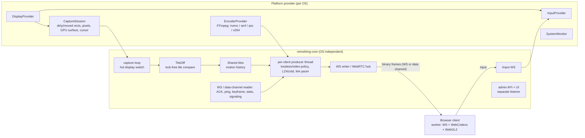
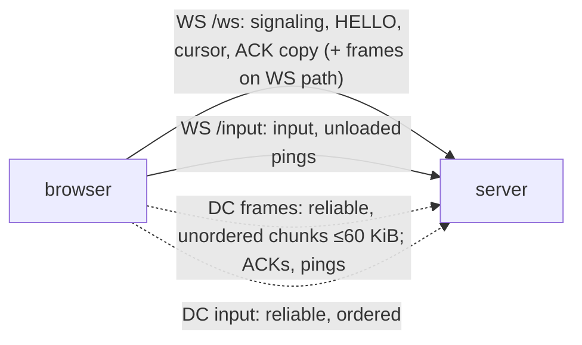

# remothing — architecture

Low-latency streaming of a desktop (or one application) to a browser. One native
binary per platform (`remothing` / `remothing.exe`), built from one Cargo
workspace; OS specifics live in providers selected with `cfg(target_os)`.

## Crates

| crate | role |
|---|---|
| `crates/core` | traits (`platform.rs`, `encode.rs`), tile diff + motion classification + policy (`shared.rs`), capture loop (`capture.rs`), wire protocol (`proto.rs`), transport (`stream.rs`), admin API (`admin.rs`), config/auth (`config.rs`), embedded web assets, server wiring (`app.rs`) |
| `crates/encoder` | FFmpeg `EncoderProvider`: H.264 NVENC / AMF / QuickSync / x264, low-latency settings, zero-copy CUDA (Linux) and D3D11 (Windows) input, host-memory fallback |
| `crates/gpu-interop` | GPU surface types shared by capture and encoder of one platform (`D3D11Frame`) |
| `crates/platform-linux` | Xvfb manager (simulated displays, shared-memory framebuffer + XDamage), real X11 displays (RandR outputs, XShm + XDamage), XTest input, XFixes cursor, NVML/DRM GPU info |
| `crates/platform-windows` | DXGI Desktop Duplication (dirty + move rects, D3D11 texture), SendInput, cursor from duplication, desktop switching, Windows service supervising the session process |
| `crates/server` | the `remothing` binary: CLI, config path, picks the platform |
| `testapp` | `rt-testapp`: latency probe app (barcode with timestamp + input marker), X11 and Win32 backends |
| `client` | browser client (`index.html`, `main.ts`, `worker.ts`) and admin UI (`admin.html`, `admin.ts`) |

## Frame path

1. **Capture** (`CaptureSession::next_frame`): the provider reports dirty
   rectangles (XDamage / DXGI dirty+move rects), optional move rects and a
   capture timestamp.
2. **Moves**: provider moves (DXGI) — or, for damage-only providers, a
   vertical scroll detected by row hashing (`Differ::detect_scroll`) — are
   applied to the shared screen copy first, so scrolled content is not seen as
   changed; clients replay them as GPU copies on their lossless layer and only
   the newly exposed strip travels.
3. **Diff** (`pixels::Differ`, capture thread): 64×64 tiles touched by the
   damage are compared with the shared screen copy (`pixels::Pixels`, one lock
   per tile row) and changed tiles are written in place. Pixels come straight
   from mapped memory (Xvfb shm) or via `read()` (XShm, D3D11 staging copy of
   the dirty tiles only). With a GPU capture surface, tiles that every client
   shows from video and whose encoder reads the GPU surface are not read back
   at all; their CPU copy is refreshed once they settle, before the lossless
   refine.
4. **Commit** (`Shared::commit`, short metadata lock): motion history, per
   client dirty/encoder-stale flags and pending moves; client threads woken.
5. **Per-client producer** (`stream.rs::produce`, one OS thread per client):
   when the client's link window allows (see *Link model*), `Shared::pull`
   builds a frame:
   - tiles changing ≥20 Hz whose lossless cost exceeds the per-frame limit or
     half of the link budget switch to the **video layer**; everything else
     is sent **lossless** (rows of tile runs: LZ4, or zstd when the link is
     under 200 Mbit/s — 1.7× smaller on desktop content);
   - a one-off change too big for ~64 ms of link time (window opened, page
     loaded) is shown from video first and refined afterwards;
   - video tiles unchanged for 250 ms (or still moving but affordable
     losslessly) are re-sent losslessly, paced by a token bucket at 80 % of
     the link so fresh changes find no queue → anything that stops moving
     becomes pixel-exact;
   - when a video tile changed, only the changed tiles are uploaded to the
     encoder input (CUDA surface / D3D11 texture copy / host frame) and one
     H.264 access unit is encoded (no B-frames, no lookahead, IDR on demand,
     SPS marked "no reordering" so browsers output each picture immediately).
     Video frames are paced to 70 % of the link and the encoder's bitrate
     cap follows the same share (NVENC VBR / x264 CRF with VBV, QP floor 20);
     cap changes cost an IDR with NVENC, so they need a clear shift and hold
     3 s unless the link collapses.
6. **Client** (`worker.ts`): frames are applied in order and atomically —
   moves, then lossless rects to one texture, decoded VideoFrame to another;
   a per-tile mask picks the layer in the WebGL2 shader. ACK after drawing,
   carrying the time the frame was held (receive → draw). zstd is decoded in
   WASM (`zstddec`, ~1.5 GB/s; pure-JS decoders stall the worker).

## Link model

`pacer.rs`, per client, from frame ACKs (client hold time subtracted, so
only the network is modelled; a slow client still holds frames back):

- **Bandwidth estimate**: raised by measured delivery rates (BBR-style
  samples, transmission time of large frames); steered by the standing queue
  — the least ACK delay beyond base RTT and the frame's own transmission over
  a window of about one RTT, so single late ACKs (relay jitter) are ignored.
  Proportional control toward 12 ms of queue (±4 %/RTT, accelerating after a
  deep cut); an emergency cut to the measured delivery rate beyond 30 ms.
  Growth needs content that waited for the estimate (window full or pacing
  deferred something).
- **Proven vs. lower bound**: until the link has queued once, the estimate
  only paces sending; what content the link affords (video vs. lossless,
  bitrate cap, zstd) is planned against the configured `bandwidth_mbps`, so
  a fast link with light content is not treated as slow.
- **Window**: estimated rate × (base RTT + jitter) with 10 % margin, so the
  frame rate is not bound by the round trip (was a fixed 2 frames); and the
  oldest unacknowledged frame must not be overdue, so a stalled client gets
  no backlog — held-back updates coalesce into one current frame.

Over Tailscale Funnel (≈18 Mbit/s, ≈50 ms) this took the harness from
10–34 fps to ~170 fps with lower latency; see `docs/RESULTS.md`.

Input goes through its own WebSocket (`/input`) so it never queues behind
frame data; the server injects it through the selected display's
`InputProvider` (display-relative coordinates, evdev key codes on the wire).

## Transport: WebSocket and WebRTC data channel

The WebSocket is always there: signaling, HELLO, cursor, pongs, and frames
unless a better path exists. `rtc.rs` (str0m, sans-IO, one hub thread, UDP
sockets on every local IPv4 address on the listen port, STUN for the
public address, `webrtc.advertise` for forwards/containers) answers the
browser's offer, so ICE can find a direct UDP path (LAN, tailnet, punched
NAT) even when the page and WebSocket go through a relay.

- **Path choice (client)**: the minimum of recent ping round trips on the
  input WebSocket (no frames queue ahead of its pongs) against the data
  channel's. Frames and input move to the data channel only when it is
  clearly shorter (8 ms or 25 %), i.e. the WebSocket is relayed; over the
  same path TCP wins: SCTP's congestion control (Reno, 1 s minimum RTO
  fixed in str0m) collapses on random loss — measured 2–5× fewer fps at
  0.5–1 % loss. The client tells the server (`{"type":"path"}` signal);
  the server resets the link model, since another path is another link.
- **Health**: a data channel in use that delivers nothing for 500 ms while a
  frame is missing, or leaves a ping unanswered for 500 ms / 4 RTTs, is
  abandoned (back to the WebSocket in ~1.3 s after UDP is cut) and banned
  for 30 s, doubling per stall up to 5 min.
- **Ordering**: frames are numbered (HELLO carries the first sequence); the
  worker reassembles chunks and applies frames strictly in order. Frames
  left on an abandoned channel never arrive: the client skips them after
  100 ms (when a later frame arrived) and reports them in the ACK; the
  server also presumes abandoned-channel frames lost after 8 RTTs (≥ 1 s).
  `recovery.rs` then repairs state, not history: it re-sends the current
  pixels of every tile a lost frame touched — following later moves, which
  the client replayed on content missing that frame — and requests a
  keyframe if the frame carried video.
- Unreliable delivery with NACK-based retransmission was tried and dropped:
  abandoned SCTP packets still count as losses for its congestion control,
  so it gained nothing over reliable unordered delivery and added repair
  storms.

## Wire protocol

Identical on every platform (`crates/core/src/proto.rs` ↔ `client/src/proto.ts`):
HELLO (geometry; re-sent when the streamed display changes), FRAME (rects +
tile layer switches + optional H.264), CURSOR (RGBA + hotspot, 0×0 = hidden),
PONG, SIGNAL (WebRTC JSON), CHUNK (data-channel piece of a FRAME); client →
server PING, ACK (with client hold time and lost frames), KEYFRAME request,
STATS (JSON for the admin UI), SIGNAL, HELLO_ACK, MOVE, BUTTON, WHEEL, KEY.

## Admin

Separate listener (`server.admin_listen`, default `127.0.0.1:8081`):
token/password login (cookie session or `Authorization: Bearer`), status
(platform, provider, encoders and fallback reasons, GPUs, CPU, clients with
fps/Mbit/s and client-reported latencies, recent errors), display selection
(hot switch), simulated display create/destroy (Linux), live settings
(bandwidth budget, lossless limit, encoder preference, keyboard layout, stream
token, admin password). Settings persist in the TOML config file.
TLS (rustls) applies to both listeners when `tls.cert`/`tls.key` are set.

## Platform notes and limitations

- **Linux / Wayland**: not supported. Capture of a Wayland session needs
  PipeWire + xdg-desktop-portal (interactive consent) or KMS/DRM access; only
  X11 servers (real or Xvfb) are handled. XWayland windows of a Wayland session
  are not a substitute (no compositor output).
- **Linux permissions**: the process must be able to connect to the X server
  (`DISPLAY`, Xauthority) — run as the session user or root with access.
- **Windows**: only physically connected outputs (DXGI); no virtual display
  driver. Secure desktops (lock screen, UAC, Ctrl+Alt+Del) and other sessions
  need the service (LocalSystem), which runs the server inside the active
  console session and relaunches it on session changes. Input to elevated
  windows and UIAccess tools (Magnifier, On-Screen Keyboard: high integrity)
  needs the elevated/service process (UIPI). Windows drops such input without
  telling SendInput, so a non-elevated server checks the foreground window's
  integrity level and reports the blocked episode once (log and admin UI).
