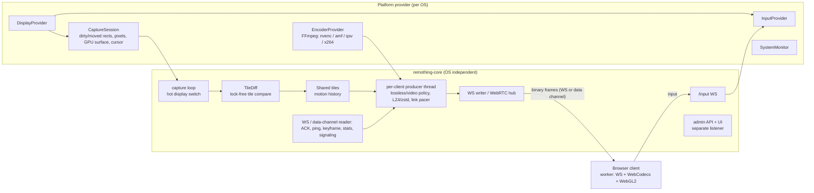
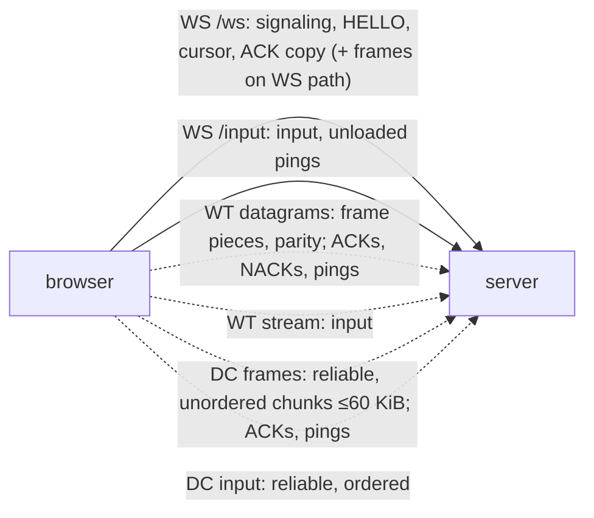

# remothing — architecture

Low-latency streaming of a desktop (or one application) to a browser. One native
binary per platform (`remothing` / `remothing.exe`), built from one Cargo
workspace; OS specifics live in providers selected with `cfg(target_os)`.

## Crates

| crate | role |
|---|---|
| `crates/core` | traits (`platform.rs`, `encode.rs`), tile diff + motion classification + policy (`shared.rs`), capture loop (`capture.rs`), wire protocol (`proto.rs`), transport (`stream.rs`), sound hub (`audio.rs`), admin API (`admin.rs`), config/auth (`config.rs`), embedded web assets, server wiring (`app.rs`) |
| `crates/encoder` | FFmpeg `EncoderProvider`: H.264 NVENC / AMF / QuickSync / x264, low-latency settings, zero-copy CUDA (Linux) and D3D11 (Windows) input, host-memory fallback; Opus (libopus) or AAC for sound |
| `crates/gpu-interop` | GPU surface types shared by capture and encoder of one platform (`D3D11Frame`) |
| `crates/platform-linux` | Xvfb manager (simulated displays, shared-memory framebuffer + XDamage), real X11 displays (RandR outputs, XShm + XDamage), XTest input, XFixes cursor, X selections (clipboard), sound through PulseAudio / PipeWire / ALSA loopback helpers, NVML/DRM GPU info |
| `crates/platform-windows` | DXGI Desktop Duplication (dirty + move rects, D3D11 texture), SendInput, cursor from duplication, clipboard, WASAPI loopback sound, desktop switching, Windows service supervising the session process |
| `crates/server` | the `remothing` binary: CLI, config path, picks the platform |
| `testapp` | `rt-testapp`: latency probe app (barcode with timestamp + input marker), X11 and Win32 backends |
| `client` | browser client (`index.html`, `main.ts`, `worker.ts`; input and touch `input.ts`, controls `ui.ts`, `keyboard.ts`, `textentry.ts`, sound `audio.ts`) and admin UI (`admin.html`, `admin.ts`) |

## Frame path

1. **Capture** (`CaptureSession::next_frame`): the provider reports dirty
   rectangles (XDamage / DXGI dirty+move rects), optional move rects and a
   capture timestamp.
2. **Moves**: provider moves (DXGI) — or, for damage-only providers, a
   vertical scroll detected by row hashing (`Differ::detect_scroll`) — are
   applied to the shared screen copy first, so scrolled content is not seen as
   changed; clients replay them as GPU copies on their lossless layer and only
   the newly exposed strip travels.
3. **Diff** (`pixels::Differ`, capture thread): 64×64 tiles touched by the
   damage are compared with the shared screen copy (`pixels::Pixels`, one lock
   per tile row) and changed tiles are written in place. Pixels come straight
   from mapped memory (Xvfb shm) or via `read()` (XShm, D3D11 staging copy of
   the dirty tiles only). With a GPU capture surface, tiles that every client
   shows from video and whose encoder reads the GPU surface are not read back
   at all; their CPU copy is refreshed once they settle, before the lossless
   refine.
4. **Commit** (`Shared::commit`, short metadata lock): motion history, per
   client dirty/encoder-stale flags and pending moves; client threads woken.
5. **Per-client producer** (`stream.rs::produce`, one OS thread per client):
   when the client's link window allows (see *Link model*), `Shared::pull`
   builds a frame:
   - tiles changing ≥20 Hz whose lossless cost exceeds the per-frame limit or
     half of the link budget switch to the **video layer**; everything else
     is sent **lossless** (rows of tile runs: LZ4, or zstd when the link is
     under 200 Mbit/s — 1.7× smaller on desktop content);
   - a one-off change too big for ~64 ms of link time (window opened, page
     loaded) is shown from video first and refined afterwards;
   - video tiles unchanged for 250 ms (or still moving but affordable
     losslessly) are re-sent losslessly, paced by a token bucket at 80 % of
     the link so fresh changes find no queue → anything that stops moving
     becomes pixel-exact;
   - when a video tile changed, only the changed tiles are uploaded to the
     encoder input (CUDA surface / D3D11 texture copy / host frame) and one
     H.264 access unit is encoded (no B-frames, no lookahead, IDR on demand,
     SPS marked "no reordering" so browsers output each picture immediately).
     Video frames are paced to 70 % of the link and the encoder's bitrate
     cap follows the same share (NVENC VBR / x264 CRF with VBV, QP floor 20);
     cap changes cost an IDR with NVENC, so they need a clear shift and hold
     3 s unless the link collapses.
6. **Client** (`worker.ts`): frames are applied in order and atomically —
   moves, then lossless rects to one texture, decoded VideoFrame to another;
   a per-tile mask picks the layer in the WebGL2 shader. ACK after drawing,
   carrying the time the frame was held (receive → draw). zstd is decoded in
   WASM (`zstddec`, ~1.5 GB/s; pure-JS decoders stall the worker).

## Motion mode

For a screen that moves as a whole: a game, a full-screen video. Weighing
tile by tile what goes to video and refining every tile that rests for a
quarter of a second suits a desktop; here it only costs: parts of the
picture hop between the layers, and every pause sends a burst of exact
pixels that is thrown away a moment later.

- **The switch** is automatic and per display (`MotionDetector` in
  `shared.rs`, sampled by the capture thread on every pass). A second is
  "moving" when at least half of the tiles were changing at 20 Hz or more
  for most of it. Ten moving seconds in a row enter the mode; forty quiet
  ones in a row leave it. Quick in and slow out on purpose: opening a
  short video, going back to folders and opening another must not flip
  the mode each time, and the mode is the safe one to be in by mistake
  (a desktop shown as video is softer, not slower).
- **In the mode** every tile that changes is shown from video at once,
  whatever it would cost losslessly, and no tile goes back to lossless
  while anything on the screen still changes. Video frames, their pacing
  and the bitrate cap are those of the frame path above. With GPU capture
  and GPU encoders no pixel is read back meanwhile.
- **The exact picture** follows once the whole screen has been still for
  5 s: the video tiles are re-sent losslessly, paced by the link as any
  refinement. A change before it is complete stops it (the tiles not yet
  sent stay video); tiles that are exact and do not change stay exact.
- **Size per client**: the client reports how it shows the picture
  (`C_VIEW`: its size in the window in device pixels, 3 s after the window
  last changed, and its refresh rate, from 60 animation frames). In motion
  mode the encoder encodes the largest of that size, the display's, and
  ¾, ⅔ and ½ of the display that fits the video cap at 0.1 bit per pixel
  and refresh (`video_size`, a first guess); never below the client's
  size. Every change is a new encoder and a keyframe, so a larger size
  waits until the link has had room for 10 s (0.5 s while slow start is
  still raising the estimate), a smaller one comes at once, and leaving
  the mode goes straight back to the display's size (tiles need it). The
  client samples the smaller picture to the screen (bilinear). Scaling:
  Windows' D3D11 input keeps a full-size copy of the changed regions that
  the GPU video processor scales into the encoder texture before each
  frame; the system-memory and CUDA inputs scale on the CPU (swscale,
  fast bilinear), the CUDA one then uploads the whole scaled picture.
- **Frame rate per client**: video frames go at most once per client
  refresh, in every mode: a grid of slots moves one refresh per frame, a
  capture up to half a refresh early for its slot goes at once (a short
  wait costs a thread wake-up that often comes milliseconds late), and
  after a gap up to two frames catch up. `?bench` reports no view: it
  measures the pipeline at the display's size and the capture rate.
- Clients without a video encoder are not affected: lossless is all they
  have. FRAME carries the mode as a flag, for the overlay and the event
  log.

## Link model

`pacer.rs`, per client, from frame ACKs (client hold time subtracted, so
only the network is modelled; a slow client still holds frames back):

- **Bandwidth estimate**: raised by measured delivery rates (BBR-style
  samples, transmission time of large frames); steered by the standing queue
  — the least ACK delay beyond base RTT and the frame's own transmission over
  a window of about one RTT, so single late ACKs (relay jitter) are ignored.
  Proportional control toward 12 ms of queue (±4 %/RTT, accelerating after a
  deep cut); an emergency cut to the measured delivery rate beyond 30 ms.
  Growth needs content that waited for the estimate (byte window full or
  pacing deferred something) and used at least a quarter of it, or content
  that used half of it; frames waiting on a client that has not drawn the
  previous ones do not count (on short paths that made it grow without
  bound), and neither does content held back by the configured bandwidth
  or the client's refresh rate: with light content no queue ever shows,
  so the estimate grew a few percent per window for good (3.2 million
  Mbit/s on a 4 ms Wi-Fi path, sending unpaced). A delivery rate is
  measured over at least a base round trip and 1 ms, so frames handed over
  together (a TCP stall released, loopback) give no sample of hundreds of
  Gbit/s.
- **Content below the estimate** (most desktop use) weakens the queue
  signal: the queue is not caused by the estimate, and a window holds one
  or two ACKs whose minimum delay is mostly jitter. So, with content under
  a quarter of the estimate, the window waits for six ACKs (or 250 ms);
  decreases made while nothing waited for the estimate are undone once the
  queue is short again, up to the level reached with content filling the
  link; and the emergency cut needs the queue to persist 200 ms (a Wi-Fi
  scan delays a few ACKs; congestion lasts). Otherwise the estimate drifted
  down to what the content happened to use (80 → 10 Mbit/s in 30 s with
  30 ms of ACK jitter), dragging the video cap along, and each cap change
  is a keyframe with NVENC.
- **Start**: a new client starts at 5 Mbit/s whatever the link: the first
  full screen sent at a fast link's rate takes a phone link seconds to
  drain. While the link has not queued yet, every judging window in which
  the content used at least half the estimate raises it, up to doubling it,
  in proportion to the share used and never beyond twice what the link just
  delivered with a short queue (doubling without that bound reached
  270 Mbit/s on an 18 Mbit/s link before the first late ACK). The first
  queue ends this phase. What the link affords (video vs. lossless, bitrate
  cap, zstd below 100 Mbit/s) is always planned against the estimate,
  bounded by `bandwidth_mbps`. Until the link has queued once, the video
  cap is twice the video share (frame pacing keeps the bytes within the
  share): video capped at the share could never show that the link carries
  more. A cap 2.5 times the current one is applied after 500 ms instead of
  the usual hold.
- **Window**: estimated rate × (base RTT + jitter) with 10 % margin, so the
  frame rate is not bound by the round trip (was a fixed 2 frames); and the
  oldest unacknowledged frame must not be overdue, so a stalled client gets
  no backlog — held-back updates coalesce into one current frame.

Over Tailscale Funnel (≈18 Mbit/s, ≈50 ms) this took the harness from
10–34 fps to ~170 fps with lower latency; see `docs/RESULTS.md`.

## Input

Input goes through its own WebSocket (`/input`) so it never queues behind
frame data, or over the data channel when frames use it; the server injects
it through the selected display's `InputProvider` (display-relative
coordinates, evdev key codes on the wire).

- **Held keys**: a key is down on the server from the client's press to its
  release, so holding it repeats on the remote side (the browser's own
  repeats are dropped). The X server repeats a held key by itself; Windows
  only repeats keys of a real keyboard, so `input.rs` sends the last
  non-modifier key again with the system's delay and rate. Each connection
  remembers the keys and buttons it holds: they are released when it ends
  or stays silent for 5 s (the client pings every second), so a dropped
  connection leaves nothing stuck.
- **Text** (`C_TEXT`): a phone's keyboard gives characters, not keys.
  Windows types them with `KEYEVENTF_UNICODE`. X11 can only press keys:
  the key of the current layout that gives the character is pressed (with
  Shift when it is the key's second symbol); a character no key gives is
  put on a keycode the layout leaves unused (eight of them in turn, since a
  program looks the symbol up when it handles the press, possibly after
  the next ones were typed) and they are emptied when the display closes.
- **Touch** (client, `input.ts`): a trackpad, on the picture and around it.
  One finger moves the pointer from where this client last put it, by as
  much as the finger travelled over the picture; a tap is a left click, a
  tap with two fingers a right click, two fingers dragged scroll, and a
  touch within 300 ms of a tap holds the left button until it ends (the
  second click of a double click when it does not move, a drag when it
  does). The
  server only ever gets absolute positions. The browser shows no cursor
  for a finger, so the remote cursor's shape (`S_CURSOR`) is drawn over
  the picture at that position.
- **Phone keyboard** (`textentry.ts`): a text field nobody sees takes the
  focus, which opens it. Phone keyboards edit the field instead of sending
  keys (composition, suggestions, swiped words), so each change is compared
  with the previous content: what went away becomes Backspace presses, what
  is new goes as text.
- **On-screen keyboard** (`keyboard.ts`): positional evdev codes like a
  real keyboard (the remote layout decides the characters), with US or
  Spanish labels; modifiers latch until the next key.

## Clipboard and display choice

`Clipboard` (per opened display, text only, up to 1 MiB): the capture side
keeps the last text with who set it in a watch channel; every client gets
changes it did not make itself (`S_CLIPBOARD`), and the current text on
connect; `C_CLIPBOARD` sets it. Windows: a message-only window on its own
thread owns the clipboard when text is set and listens for
`WM_CLIPBOARDUPDATE`; it reads 100 ms after the last update, because the
program that copies is often still writing (OLE sets the data, then flushes
it) and opening the clipboard under it makes its copy fail. X11: XFixes
selection notifications on `CLIPBOARD`, `UTF8_STRING` conversion (INCR for
large texts), and ownership of the selection, answering requests, when a
client sets it.

`C_DISPLAYS` asks for the display list (`S_DISPLAYS`, JSON with the current
one), `C_DISPLAY` selects one, the same hot switch as the admin UI: every
client gets a new HELLO.

## Sound

Best effort: video never depends on it. `audio.rs` runs one capture thread
while at least one client listens (`C_AUDIO`): the platform's `AudioSource`
gives 48 kHz stereo 16-bit samples, one encoder serves every listener, and
each packet goes out on the clients' WebSockets (`S_AUDIO`), after an
`S_AUDIO_INFO` that names codec and source or tells why there is no sound.
Both the source and the encoder report everything they tried; that list is
in the server log, in the admin status and in the client (overlay, tooltip
of the `Sound` button, event log). A failure is tried again every 15 s.
After a second of plain zeros nothing is sent until something plays.

- **Encoder** (`crates/encoder/src/audio.rs`): libopus at 128 kbit/s in
  10 ms frames, music mode only (no look-ahead); FFmpeg's own AAC encoder
  when the build has no libopus (21 ms frames, one held back).
- **Windows**: WASAPI loopback of the default playback device, converted
  by the audio engine to our format, polled (loopback has no usable
  event). It delivers nothing while nothing plays. The device is reopened
  when the default one changes.
- **Linux** has no one place to read what plays, so paths are tried in
  order, each a helper program writing samples to a pipe (they fail with a
  message worth logging, and no sound library has to be linked): `parec` on
  the default sink's monitor of a PulseAudio-protocol server (PulseAudio
  or pipewire-pulse; ours, the server user's, or any logged-in user's under
  `/run/user`, with that user's cookie); `pw-record` on PipeWire's default
  sink; `arecord` on an ALSA loopback card. Where no sound server runs at
  all (a container), the platform starts one before the sessions:
  PulseAudio with a null sink, else PipeWire + WirePlumber + pipewire-pulse
  with a null sink and their own D-Bus session bus. Sessions started in
  simulated displays get its address as `PULSE_SERVER`.
- **Client** (`audio.ts`): WebCodecs `AudioDecoder`, each decoded piece
  scheduled on an `AudioContext` right after the previous one, 60 ms ahead
  of the clock when the queue is empty; pieces that would queue more than
  250 ms ahead are dropped (a burst after a stall would otherwise stay
  late for good). Browsers only play after a click or key, so sound is
  asked for at the first one. No WebCodecs (plain HTTP): no sound, and the
  client says so.

## Microphone

The other direction: a client's microphone as the session's microphone
(`mic.rs`). The browser records it (`getUserMedia`, with its echo
cancellation, since the remote sound plays on the same page), an
AudioWorklet hands over the samples and they go to the server on the
WebSocket (`C_MIC`) as Opus (WebCodecs `AudioEncoder`, mono, 32 kbit/s,
20 ms packets) or, where the browser cannot encode, as plain 16 kHz
samples. The server decodes (FFmpeg's Opus decoder; plain samples are
interpolated to 48 kHz) and plays into the platform's `AudioSink`, the
virtual microphone that programs of the session record from.

- **One talker, decided by the server**: the first `C_MIC_INFO {"on":true}`
  to arrive gets the microphone (a compare-and-set on a watch channel that
  every session follows). The others get `S_MIC_INFO` `busy`, which
  disables their button, and `free` when it is released: switched off, or
  the talker's connection ended. There is no server setting: the
  microphone is always on offer and clients decide.
- **Playout**: one thread per talker. Every 10 ms of the server's clock the
  sink gets one piece: the client's sound when at least 60 ms were queued
  (and until the queue runs out), silence otherwise. The client's clock
  runs a little faster or slower than the server's; more than 250 ms queued
  is cut back to 60 ms. A device fed evenly never runs dry.
- **Linux** (`platform-linux/src/microphone.rs`): a null sink
  `remothing-mic-sink` and the source `remothing-mic` over its monitor (a
  remapped source: many programs leave monitors out of their microphone
  list), made with `pactl`; `pacat` plays into the sink. In our own sound
  server the pair exists from the start and is the default source. In
  somebody else's it is made when a client starts talking and is the
  default source meanwhile; the previous default comes back and the pair is
  removed afterwards. PipeWire without pulseaudio-utils: `pw-loopback`
  makes the pair and `pw-cat` plays into it (one virtual source node is
  not enough: the session manager links players to sinks only).
- **Windows** (`platform-windows/src/microphone.rs`): there is no way to
  make a microphone without a kernel driver, and a driver only loads with
  Microsoft's signature, which no open-source virtual cable has today. So
  VB-CABLE is used (VB-Audio, donationware, www.vb-cable.com; its licence
  allows other applications to install its package as it is when its
  origin is shown): the server plays into `CABLE Input` with WASAPI (or
  into `CABLE In 16ch`, the same cable's other playing end, when the first
  refuses: seen right after installing, before a restart) and programs
  record `CABLE Output`, which is made the default recording device while
  a client talks (the undocumented `IPolicyConfig`, as the Sound control
  panel does) and put back afterwards.
- **Installing it** only happens when a client asks. Without the cable the
  talker gets `install` with what is missing and whose it is; the client
  asks the user, warning that the server will want administrator consent
  and may have to restart. On yes the server downloads the package from
  VB-Audio, checks it against the SHA-256 this build knows, and runs its
  setup elevated (`ShellExecute` "runas": Windows asks on the server's own
  screen unless remothing runs elevated). Playback and recording defaults
  are put back if the new device took them. Then the cable is opened; if
  it only appears after a restart, the client offers to restart the
  computer (`restart`). An installed cable is simply used.

## Transport: WebTransport, WebRTC data channel, WebSocket

The WebSocket is always there: signaling, HELLO, cursor, pongs, and frames
unless a better path exists. Frames prefer UDP, where a lost packet does
not hold back everything sent after it as it does on TCP (a game session
on Wi-Fi showed 200 ms stalls with nothing but the network to blame:
TCP's retransmission timeout). Two UDP paths, in this order:

1. **WebTransport** (`wt.rs`, wtransport/quinn), tried at every connection
   and used whenever it is up, in both modes.
2. **WebRTC data channel** (`rtc.rs`, str0m, sans-IO, one hub thread, UDP
   sockets on every local IPv4 address on the listen port, STUN for the
   public address, `webrtc.advertise` for forwards/containers), answering
   the browser's offer so ICE can find a direct UDP path (LAN, tailnet,
   punched NAT) even when the page and WebSocket go through a relay. Used
   only when its round trip is clearly shorter (below).

### WebTransport

- **Reaching it**: its own UDP port (`webtransport.port`, default one above
  `server.listen`, whose UDP side is WebRTC's). The server offers over the
  WebSocket a session key, the port, the places to try (the page's own
  host, `webtransport.advertise`, this machine's addresses) and the hash of
  its certificate; the client tries them all at once and keeps the first
  that answers. The key ties the session to that WebSocket session, which
  the stream token already authorized.
- **Certificate**: browsers check WebTransport like HTTPS and show no
  warning to click through. Unless `tls.cert`/`tls.key` hold a CA-signed
  certificate, the server makes its own ECDSA P-256 one, valid 13 days
  (browsers accept a certificate pinned by hash only under two weeks),
  renews it every 5 days and sends the new hash; the client pins it with
  `serverCertificateHashes`. It is trusted as much as the page that brought
  the hash, whatever made the page trusted (a proxy's certificate in front,
  or our self-signed one accepted once): no second certificate to obtain.
  QUIC has no unencrypted form, so a proxy in front cannot end TLS for a
  plain WebTransport backend; the page can go through it while the
  datagrams go straight to the server, a plain UDP forward on the proxy
  host carries them untouched, and a full `https://` URL in `advertise`
  points at a proxy that ends WebTransport itself (checked as any HTTPS
  site; not tried here).
- **Frames** go as pieces of at most 1100 bytes (they fit the smallest QUIC
  packet), plus one parity piece per 8: the XOR of every 8th piece, so one
  lost piece per group, or a run of up to one piece per group, is rebuilt
  without a round trip. What is still missing is asked for again
  (`C_NACK`): holes behind later pieces after 4 ms, the rest of a frame
  once its pieces stopped for 4 ms and three times their usual spacing (on
  a slow link they come far apart), or when a later frame arrives; again
  after 1.5 round trips, up to five times. A frame that got nothing new for
  250 ms (or 4 round trips) is given up: the ACK lists it as lost and the
  repair below follows. The server keeps the last 256 unacknowledged
  frames for these requests.
- **Rate**: QUIC's own congestion control is switched off (a window
  beyond what quinn paces). Frames are already paced by the link model,
  and a second controller would hold datagrams back, and drop the oldest,
  on losses it reads as congestion. A frame that was only complete after
  asking again says so in its ACK, and its timing is not a link sample.
- **Health**: the session is given up when it closes or a ping (every
  250 ms) stays unanswered for 300 ms (or 4 round trips), and not tried
  again for 30 s, doubling up to 5 min; a failed attempt counts the same.
  Frames then take the data channel or the WebSocket, with the same repair
  as an abandoned data channel. A new WebSocket connection starts afresh.
- **Input** goes over one unidirectional stream (ordered, each message
  after its length).
- An unreliable *data channel* with our own retransmission was tried
  before and dropped (SCTP shrinks its window for what it abandons); with
  QUIC the sending rate is ours to set, which is what makes the same idea
  work here.

### Data channel

- **Path choice (client)**: the minimum of recent ping round trips on the
  input WebSocket (no frames queue ahead of its pongs) against the data
  channel's. Frames and input move to the data channel only when it is
  clearly shorter (8 ms or 25 %), i.e. the WebSocket is relayed; over the
  same path TCP wins: SCTP's congestion control (Reno, 1 s minimum RTO
  fixed in str0m) collapses on random loss — measured 2–5× fewer fps at
  0.5–1 % loss. The client tells the server (`{"type":"path"}` signal);
  the link model restarts from the last estimate, since most of the route
  is shared (a fallback to the WebSocket also keeps content within it).
- **Health**: the data channel in use is given up, and not used again for
  30 s (doubling each time, up to 5 min), when
  - a frame is still missing 150 ms (or 4 RTTs) after a later one arrived:
    a packet was lost and everything behind it waits for SCTP;
  - a ping (every 250 ms while in use) stays unanswered for 300 ms (or
    4 RTTs): the path died, or SCTP stopped delivering;
  - the server's estimate there falls below half of what the WebSocket
    carried (`{"type":"slow"}` signal): SCTP under loss often does not
    stall, it just carries a fraction (measured 4 Mbit/s and 50 fps where
    the relayed WebSocket gave 14 Mbit/s and 169 fps).
- **Ordering and repair**: frames are numbered (HELLO carries the first
  sequence); the worker reassembles chunks and applies frames strictly in
  order. When the client gives the channel up it says so (`dead`): the
  server treats everything unacknowledged there as lost at once, and the
  client skips what is missing when the next frame arrives over the
  WebSocket. (After a switch by choice it waits 100 ms for stragglers and
  reports the rest in the ACK; the server presumes them lost after 8 RTTs,
  ≥ 1 s.) `recovery.rs` repairs state, not history: the current pixels of
  every tile whose lossless copy a lost frame set — following later moves,
  which the client replayed on content missing that frame — and the layer
  of tiles whose switch was lost. Tiles shown from video on both sides need
  only the keyframe that a lost video frame triggers anyway; re-sending
  them losslessly turned a fallback during full-screen video into a 2.5 s
  freeze (now ~0.6 s, mostly detection).
- Unreliable delivery with NACK-based retransmission was tried and dropped:
  abandoned SCTP packets still count as losses for its congestion control,
  so it gained nothing over reliable unordered delivery and added repair
  storms.

## Wire protocol

Identical on every platform (`crates/core/src/proto.rs` ↔ `client/src/proto.ts`):
HELLO (geometry; re-sent when the streamed display changes), FRAME (rects +
tile layer switches + optional H.264), CURSOR (RGBA + hotspot, 0×0 = hidden),
PONG, SIGNAL (WebRTC and WebTransport JSON), CHUNK (data-channel piece of a
FRAME), PIECE (WebTransport datagram piece of a FRAME, or parity), CLIPBOARD
(text), DISPLAYS (JSON list), AUDIO_INFO (JSON: codec and source, or why
there is no sound), AUDIO (one encoded packet), MIC_INFO (JSON: the
microphone is free, taken, playing, needs something installed, needs a
restart, or why not); client → server PING, ACK (with client hold time and
lost frames), KEYFRAME request (with the newest frame received: requests
the last keyframe already answers are ignored, since the client sends one
per undecodable frame), STATS (JSON for the admin UI), SIGNAL, HELLO_ACK,
VISIBLE (a hidden tab gets no frames; changes accumulate into one frame for
when it shows again), EVENT (text for the event log), CLIPBOARD, DISPLAYS,
DISPLAY, AUDIO (on/off), MIC_INFO (JSON: ask for the microphone, release
it, agree to install or restart), MIC (one packet), MOVE, BUTTON, WHEEL,
KEY, TEXT, NACK (WebTransport pieces to send again), VIEW (picture size in
the window and refresh rate).

## Admin

Separate listener (`server.admin_listen`, default `127.0.0.1:8081`):
token/password login (cookie session or `Authorization: Bearer`), status
(platform, provider, encoders and fallback reasons, GPUs, CPU, clients with
fps/Mbit/s and client-reported latencies, recent errors, and per-client
events: path switches, estimate cuts, video cap changes, lost frames,
keyframe requests, and the stutters the client saw — frames drawn more than
200 ms after their change, with the split of the worst one: on the server
waiting until the frame was built (link window, pacing), encoder upload,
encoding and the rest until sent; network; client), mode and size
changes, the view each client reports, display selection
(hot switch), simulated display create/destroy (Linux), live settings
(bandwidth budget, lossless limit, encoder preference, keyboard layout, stream
token, admin password). Settings persist in the TOML config file.
TLS (rustls) applies to both listeners when `tls.cert`/`tls.key` are set.

## Platform notes and limitations

- **Scheduling** (`Platform::thread_priority`, `Platform::streaming`):
  the capture thread asks for the highest priority, producers, network
  runtime, WebRTC hub and sound above normal. On Windows, while at least
  one client is connected, the process also gets the high priority class,
  the realtime GPU scheduling class (whether or not hardware-accelerated
  GPU scheduling is on; Sunshine reports NVIDIA driver freezes with it
  under HAGS), a 1 ms system timer and the compositor scheduled as
  multimedia (`DwmEnableMMCSS`); all reverted when the last client
  leaves. Measured before it was built (task 003, "Measured under load"):
  with every CPU busy the server stalled 70-140 ms many times a second
  until its class was high; with the GPU busy encoding took three times as
  long until its GPU class was realtime. The admin status lists what was
  applied. On Linux the threads get a lower nice value, which needs
  CAP_SYS_NICE.
- **Linux / Wayland**: not supported. Capture of a Wayland session needs
  PipeWire + xdg-desktop-portal (interactive consent) or KMS/DRM access; only
  X11 servers (real or Xvfb) are handled. XWayland windows of a Wayland session
  are not a substitute (no compositor output).
- **Linux permissions**: the process must be able to connect to the X server
  (`DISPLAY`, Xauthority) — run as the session user or root with access.
- **Windows**: only physically connected outputs (DXGI); no virtual display
  driver. Secure desktops (lock screen, UAC, Ctrl+Alt+Del) and other sessions
  need the service (LocalSystem), which runs the server inside the active
  console session and relaunches it on session changes. Input to elevated
  windows and UIAccess tools (Magnifier, On-Screen Keyboard: high integrity)
  needs the elevated/service process (UIPI). Windows drops such input without
  telling SendInput, so a non-elevated server checks the foreground window's
  integrity level and reports the blocked episode once (log and admin UI).
