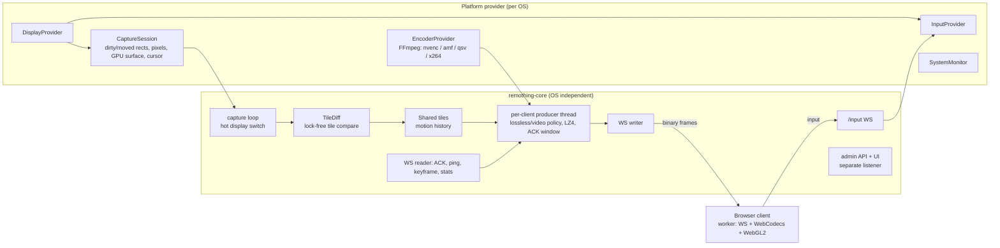

# remothing — architecture

Low-latency streaming of a desktop (or one application) to a browser. One native
binary per platform (`remothing` / `remothing.exe`), built from one Cargo
workspace; OS specifics live in providers selected with `cfg(target_os)`.

## Crates

| crate | role |
|---|---|
| `crates/core` | traits (`platform.rs`, `encode.rs`), tile diff + motion classification + policy (`shared.rs`), capture loop (`capture.rs`), wire protocol (`proto.rs`), transport (`stream.rs`), admin API (`admin.rs`), config/auth (`config.rs`), embedded web assets, server wiring (`app.rs`) |
| `crates/encoder` | FFmpeg `EncoderProvider`: H.264 NVENC / AMF / QuickSync / x264, low-latency settings, zero-copy CUDA (Linux) and D3D11 (Windows) input, host-memory fallback |
| `crates/gpu-interop` | GPU surface types shared by capture and encoder of one platform (`D3D11Frame`) |
| `crates/platform-linux` | Xvfb manager (simulated displays, shared-memory framebuffer + XDamage), real X11 displays (RandR outputs, XShm + XDamage), XTest input, XFixes cursor, NVML/DRM GPU info |
| `crates/platform-windows` | DXGI Desktop Duplication (dirty + move rects, D3D11 texture), SendInput, cursor from duplication, desktop switching, Windows service supervising the session process |
| `crates/server` | the `remothing` binary: CLI, config path, picks the platform |
| `testapp` | `rt-testapp`: latency probe app (barcode with timestamp + input marker), X11 and Win32 backends |
| `client` | browser client (`index.html`, `main.ts`, `worker.ts`) and admin UI (`admin.html`, `admin.ts`) |

## Frame path

1. **Capture** (`CaptureSession::next_frame`): the provider reports dirty
   rectangles (XDamage / DXGI dirty+move rects), optional move rects and a
   capture timestamp.
2. **Moves**: provider moves (DXGI) — or, for damage-only providers, a
   vertical scroll detected by row hashing (`Differ::detect_scroll`) — are
   applied to the shared screen copy first, so scrolled content is not seen as
   changed; clients replay them as GPU copies on their lossless layer and only
   the newly exposed strip travels.
3. **Diff** (`pixels::Differ`, capture thread): 64×64 tiles touched by the
   damage are compared with the shared screen copy (`pixels::Pixels`, one lock
   per tile row) and changed tiles are written in place. Pixels come straight
   from mapped memory (Xvfb shm) or via `read()` (XShm, D3D11 staging copy of
   the dirty tiles only). With a GPU capture surface, tiles that every client
   shows from video and whose encoder reads the GPU surface are not read back
   at all; their CPU copy is refreshed once they settle, before the lossless
   refine.
4. **Commit** (`Shared::commit`, short metadata lock): motion history, per
   client dirty/encoder-stale flags and pending moves; client threads woken.
5. **Per-client producer** (`stream.rs::produce`, one OS thread per client):
   when the ACK window (2 frames in flight) allows, `Shared::pull` builds a
   frame:
   - tiles changing ≥20 Hz whose lossless cost exceeds the per-frame limit or
     half of the bandwidth budget switch to the **video layer**; everything
     else is sent **lossless** (LZ4 rows of tile runs);
   - video tiles unchanged for 250 ms are re-sent losslessly → anything that
     stops moving becomes pixel-exact;
   - when a video tile changed, only the changed tiles are uploaded to the
     encoder input (CUDA surface / D3D11 texture copy / host frame) and one
     H.264 access unit is encoded (no B-frames, no lookahead, IDR on demand,
     SPS marked "no reordering" so browsers output each picture immediately).
6. **Client** (`worker.ts`): frames are applied in order and atomically —
   moves, then lossless rects to one texture, decoded VideoFrame to another;
   a per-tile mask picks the layer in the WebGL2 shader. ACK after drawing.

Input goes through its own WebSocket (`/input`) so it never queues behind
frame data; the server injects it through the selected display's
`InputProvider` (display-relative coordinates, evdev key codes on the wire).

## Wire protocol

Identical on every platform (`crates/core/src/proto.rs` ↔ `client/src/proto.ts`):
HELLO (geometry; re-sent when the streamed display changes), FRAME (rects +
tile layer switches + optional H.264), CURSOR (RGBA + hotspot, 0×0 = hidden),
PONG; client → server PING, ACK, KEYFRAME request, STATS (JSON for the admin
UI), MOVE, BUTTON, WHEEL, KEY.

## Admin

Separate listener (`server.admin_listen`, default `127.0.0.1:8081`):
token/password login (cookie session or `Authorization: Bearer`), status
(platform, provider, encoders and fallback reasons, GPUs, CPU, clients with
fps/Mbit/s and client-reported latencies, recent errors), display selection
(hot switch), simulated display create/destroy (Linux), live settings
(bandwidth budget, lossless limit, encoder preference, keyboard layout, stream
token, admin password). Settings persist in the TOML config file.
TLS (rustls) applies to both listeners when `tls.cert`/`tls.key` are set.

## Platform notes and limitations

- **Linux / Wayland**: not supported. Capture of a Wayland session needs
  PipeWire + xdg-desktop-portal (interactive consent) or KMS/DRM access; only
  X11 servers (real or Xvfb) are handled. XWayland windows of a Wayland session
  are not a substitute (no compositor output).
- **Linux permissions**: the process must be able to connect to the X server
  (`DISPLAY`, Xauthority) — run as the session user or root with access.
- **Windows**: only physically connected outputs (DXGI); no virtual display
  driver. Secure desktops (lock screen, UAC, Ctrl+Alt+Del) and other sessions
  need the service (LocalSystem), which runs the server inside the active
  console session and relaunches it on session changes. Input to elevated
  windows and UIAccess tools (Magnifier, On-Screen Keyboard: high integrity)
  needs the elevated/service process (UIPI). Windows drops such input without
  telling SendInput, so a non-elevated server checks the foreground window's
  integrity level and reports the blocked episode once (log and admin UI).
